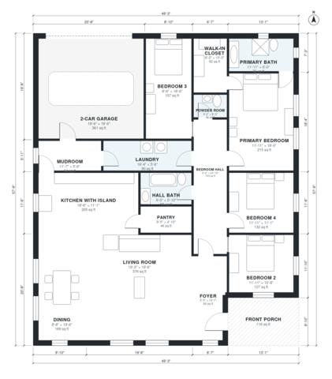

# 4 Bedroom One Story House Plans: 2,320 Sq Ft Layout

A single-story 4-bedroom, 2.5-bath modern farmhouse of about 210 m² (roughly 2,300 sq ft) of living space, plus a 2-car garage and a front porch. The front porch opens to a foyer and a large open kitchen, dining and living area. A central bedroom hall serves the primary suite, three bedrooms and the baths. The garage connects through a mudroom and laundry.

| | |
|---|---|
| Levels | 1 |
| Footprint | 15.0 m × 17.6 m (49 ft × 58 ft) |
| Rooms | 17 indoor, 1 outdoor |
| Indoor area including garage, from the room grid | about 253 m² (2,725 sq ft) |

## Files here

- `area-schedule.csv` (room schedule)
- `building.json` (rooms, walls, openings as data)
- `plan-level1.dxf` (floor plan, DXF, drawing units: inches)

## More for this plan

- Plan page with the PDF plan set, IFC and 3D model, and a tool to change the plan: https://floorplan.ai-architectures.com/house-plans/4-bedroom-one-story-house-plans?utm_source=github-plans&utm_medium=probe&utm_campaign=github
- PDF plan set: https://storage.googleapis.com/20img/house-plans/4-bedroom-one-story-house-plans/plan-set.pdf
- IFC model: https://storage.googleapis.com/20img/house-plans/4-bedroom-one-story-house-plans/model.ifc

## Known issues in this drawing

- Primary Bath is 6.7 m² (asked for about 10.0 m²).

Concept design generated with AI. Not for construction or permit; verify with a licensed professional.
