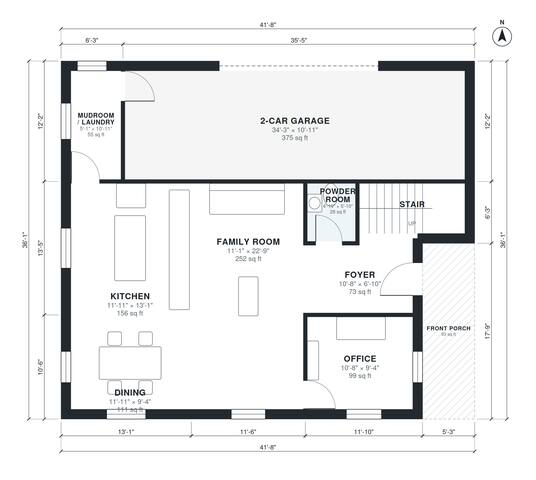

# 4 Bedroom Open Floor Plan House Plans: 2,480 Sq Ft, 2-Story

This is a two-story traditional home with about 225 m² (roughly 2,430 sq ft) of living space plus a 38 m² attached 2-car garage. The ground floor has a covered front porch, a foyer with the stair, an open kitchen, dining and family room, an office, a powder room, and a mudroom/laundry linking the garage to the kitchen. Upstairs, four bedrooms and a hall bath open off a central hall, including a primary suite with a bath and walk-in closet. A bonus room sits over the garage.

| | |
|---|---|
| Levels | 2 |
| Footprint | 12.7 m × 11.0 m (42 ft × 36 ft) |
| Rooms | 20 indoor, 1 outdoor |
| Indoor area including garage, from the room grid | about 271 m² (2,914 sq ft) |

## Files here

- `area-schedule.csv` (room schedule)
- `building.json` (rooms, walls, openings as data)
- `plan-level1.dxf` (floor plan, DXF, drawing units: inches)
- `plan-level2.dxf` (floor plan, DXF, drawing units: inches)

## More for this plan

- Plan page with the PDF plan set, IFC and 3D model, and a tool to change the plan: https://floorplan.ai-architectures.com/house-plans/4-bedroom-open-floor-plan-house-plans?utm_source=github-plans&utm_medium=probe&utm_campaign=github
- PDF plan set: https://storage.googleapis.com/20img/house-plans/4-bedroom-open-floor-plan-house-plans/plan-set.pdf
- IFC model: https://storage.googleapis.com/20img/house-plans/4-bedroom-open-floor-plan-house-plans/model.ifc

## Known issues in this drawing

- Mudroom / Laundry is 5.1 m² (asked for about 7.0 m²).
- Bedroom 2 is 16.3 m² (asked for about 13.0 m²).

Concept design generated with AI. Not for construction or permit; verify with a licensed professional.
