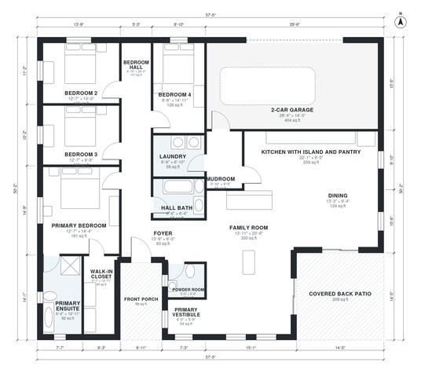

# 4 Bedroom Ranch House Plans: 2,130 Sq Ft Split-Bedroom Layout

A single-story split-bedroom ranch of about 2,150 sq ft of living space, plus a 2-car garage, front porch and covered back patio. The primary suite, with its walk-in closet and ensuite, sits on one side behind a short vestibule. Three bedrooms and a hall bath sit on the other side off a dedicated bedroom hall. The kitchen with island, dining and family room form an open core. The mudroom and laundry connect the garage to the kitchen.

| | |
|---|---|
| Levels | 1 |
| Footprint | 17.5 m × 15.3 m (57 ft × 50 ft) |
| Rooms | 17 indoor, 2 outdoor |
| Indoor area including garage, from the room grid | about 240 m² (2,585 sq ft) |

## Files here

- `area-schedule.csv` (room schedule)
- `building.json` (rooms, walls, openings as data)
- `plan-level1.dxf` (floor plan, DXF, drawing units: inches)

## More for this plan

- Plan page with the PDF plan set, IFC and 3D model, and a tool to change the plan: https://floorplan.ai-architectures.com/house-plans/4-bedroom-ranch-house-plans?utm_source=github-plans&utm_medium=probe&utm_campaign=github
- PDF plan set: https://storage.googleapis.com/20img/house-plans/4-bedroom-ranch-house-plans/plan-set.pdf
- IFC model: https://storage.googleapis.com/20img/house-plans/4-bedroom-ranch-house-plans/model.ifc

## Known issues in this drawing

- Primary Vestibule and Primary Bedroom are not directly connected.

Concept design generated with AI. Not for construction or permit; verify with a licensed professional.
