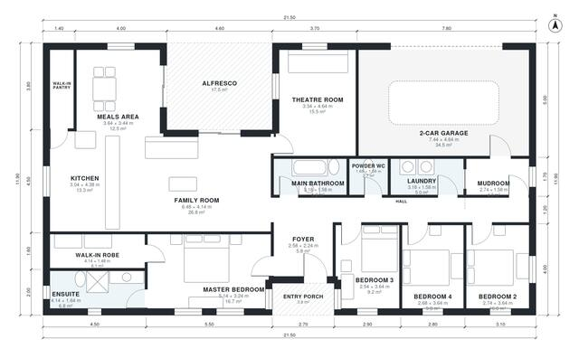

# 4 Bedroom Single Storey House Plans: 2,110 Sq Ft Design

A single-storey 4-bedroom, 2-bath Australian-style home of about 242 m² including the 38 m² garage and the alfresco. The master suite with walk-in robe and ensuite sits at the front. The open kitchen, walk-in pantry, family and meals area at the back opens to a covered alfresco. The theatre room moves to the front hall so the family room can be wider. The 2-car garage connects through the mudroom and laundry.

| | |
|---|---|
| Levels | 1 |
| Footprint | 21.5 m × 11.9 m (71 ft × 39 ft) |
| Rooms | 18 indoor, 2 outdoor |
| Indoor area including garage, from the room grid | about 235 m² (2,525 sq ft) |

## Files here

- `area-schedule.csv` (room schedule)
- `building.json` (rooms, walls, openings as data)
- `plan-level1.dxf` (floor plan, DXF, drawing units: millimetres)

## More for this plan

- Plan page with the PDF plan set, IFC and 3D model, and a tool to change the plan: https://floorplan.ai-architectures.com/house-plans/4-bedroom-single-storey-house-plans?utm_source=github-plans&utm_medium=probe&utm_campaign=github
- PDF plan set: https://storage.googleapis.com/20img/house-plans/4-bedroom-single-storey-house-plans/plan-set.pdf
- IFC model: https://storage.googleapis.com/20img/house-plans/4-bedroom-single-storey-house-plans/model.ifc

## Known issues in this drawing

- Foyer and Theatre Room are not directly connected.
- Walk-in Pantry is 3.6 m² (asked for about 5.0 m²).

Concept design generated with AI. Not for construction or permit; verify with a licensed professional.
