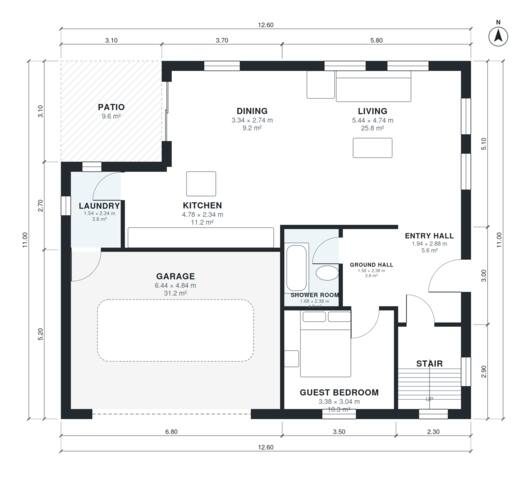

# 4 Bedroom Two Story House Plans with Garage | 1,820 Sq Ft

A compact two-storey family house of about 170 m² of living space plus an attached 2-car garage. The ground floor has an open kitchen, dining and living area opening to a patio, a laundry, and a guest bedroom with its own shower room. Upstairs are the primary suite with ensuite and walk-in closet, two further bedrooms and a family bath off a central landing.

| | |
|---|---|
| Levels | 2 |
| Footprint | 12.6 m × 11.0 m (41 ft × 36 ft) |
| Rooms | 18 indoor, 2 outdoor |
| Indoor area including garage, from the room grid | about 205 m² (2,205 sq ft) |

## Files here

- `area-schedule.csv` (room schedule)
- `building.json` (rooms, walls, openings as data)
- `plan-level1.dxf` (floor plan, DXF, drawing units: millimetres)
- `plan-level2.dxf` (floor plan, DXF, drawing units: millimetres)

## More for this plan

- Plan page with the PDF plan set, IFC and 3D model, and a tool to change the plan: https://floorplan.ai-architectures.com/house-plans/4-bedroom-two-story-house-plans-with-garage?utm_source=github-plans&utm_medium=probe&utm_campaign=github
- PDF plan set: https://storage.googleapis.com/20img/house-plans/4-bedroom-two-story-house-plans-with-garage/plan-set.pdf
- IFC model: https://storage.googleapis.com/20img/house-plans/4-bedroom-two-story-house-plans-with-garage/model.ifc

## Known issues in this drawing

- Laundry is 3.6 m² (asked for about 5.0 m²).
- Kitchen has no window.
- Bedroom 3 is only 1.94 m wide.

Concept design generated with AI. Not for construction or permit; verify with a licensed professional.
