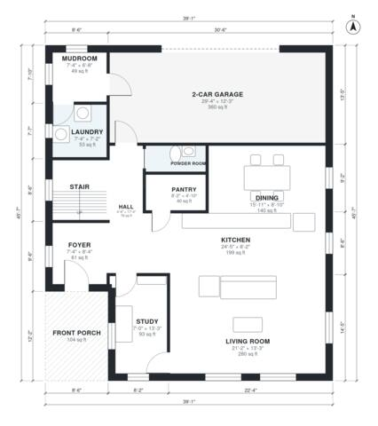

# 4 Bedroom Two Story House Plans: 2,480 Sq Ft with Garage

This two-story modern farmhouse has about 236 m² (roughly 2,540 sq ft) of living space, plus a 2-car garage and a front porch. The ground floor has an open kitchen, dining and living area, a study, a powder room, laundry, mudroom and pantry. Upstairs, four bedrooms open off a central hall, including a primary suite with a walk-in closet and bath, plus a shared hall bath.

| | |
|---|---|
| Levels | 2 |
| Footprint | 11.9 m × 13.9 m (39 ft × 46 ft) |
| Rooms | 21 indoor, 2 outdoor |
| Indoor area including garage, from the room grid | about 268 m² (2,889 sq ft) |

## Files here

- `area-schedule.csv` (room schedule)
- `building.json` (rooms, walls, openings as data)
- `plan-level1.dxf` (floor plan, DXF, drawing units: inches)
- `plan-level2.dxf` (floor plan, DXF, drawing units: inches)

## More for this plan

- Plan page with the PDF plan set, IFC and 3D model, and a tool to change the plan: https://floorplan.ai-architectures.com/house-plans/4-bedroom-two-story-house-plans?utm_source=github-plans&utm_medium=probe&utm_campaign=github
- PDF plan set: https://storage.googleapis.com/20img/house-plans/4-bedroom-two-story-house-plans/plan-set.pdf
- IFC model: https://storage.googleapis.com/20img/house-plans/4-bedroom-two-story-house-plans/model.ifc

## Known issues in this drawing

- Hall and Laundry are not directly connected.
- Foyer is 5.7 m² (asked for about 8.0 m²).

Concept design generated with AI. Not for construction or permit; verify with a licensed professional.
