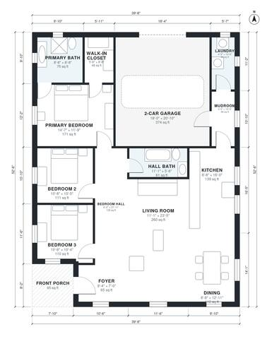

# 40 Ft Wide House Plans: 3 Bed, 2 Bath, 1,620 Sq Ft One Story

This is a single-story, 3-bedroom, 2-bath ranch, 39'8" wide and 52'6" deep. It has about 1,600 sq ft of living space plus a 2-car garage at the front and a covered porch. The kitchen, dining and living areas form one open space on the east side. The primary suite, with its bath and walk-in closet, is in the northwest corner. The garage connects through a mudroom to the kitchen and laundry.

| | |
|---|---|
| Levels | 1 |
| Footprint | 12.1 m × 16.0 m (40 ft × 52 ft) |
| Rooms | 14 indoor, 1 outdoor |
| Indoor area including garage, from the room grid | about 188 m² (2,019 sq ft) |

## Files here

- `area-schedule.csv` (room schedule)
- `building.json` (rooms, walls, openings as data)
- `plan-level1.dxf` (floor plan, DXF, drawing units: inches)

## More for this plan

- Plan page with the PDF plan set, IFC and 3D model, and a tool to change the plan: https://floorplan.ai-architectures.com/house-plans/40-ft-wide-house-plans?utm_source=github-plans&utm_medium=probe&utm_campaign=github
- PDF plan set: https://storage.googleapis.com/20img/house-plans/40-ft-wide-house-plans/plan-set.pdf
- IFC model: https://storage.googleapis.com/20img/house-plans/40-ft-wide-house-plans/model.ifc

## Known issues in this drawing

- Living Room is only 3.38 m wide.
- Laundry is 4.1 m² (asked for about 6.0 m²).

Concept design generated with AI. Not for construction or permit; verify with a licensed professional.
