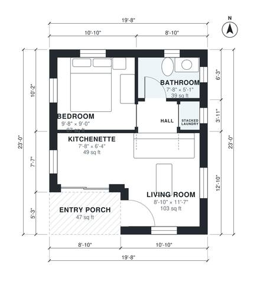

# 400 Sq Ft ADU Plans: 1 Bed, 1 Bath Detached Backyard Unit

This is a compact one-bedroom backyard ADU with about 37.6 m² (about 405 sq ft) of indoor space, plus a small covered entry porch. The front door opens into an open living room and kitchenette. A short hall leads to a separate walled bedroom, a full bath and a stacked washer/dryer closet. The kitchenette and bath came out slightly smaller than first sketched, which is normal at this size.

| | |
|---|---|
| Levels | 1 |
| Footprint | 6.0 m × 7.0 m (20 ft × 23 ft) |
| Rooms | 6 indoor, 1 outdoor |
| Indoor area including garage, from the room grid | about 38 m² (406 sq ft) |

## Files here

- `area-schedule.csv` (room schedule)
- `building.json` (rooms, walls, openings as data)
- `plan-level1.dxf` (floor plan, DXF, drawing units: inches)

## More for this plan

- Plan page with the PDF plan set, IFC and 3D model, and a tool to change the plan: https://floorplan.ai-architectures.com/house-plans/400-sq-ft-adu-plans?utm_source=github-plans&utm_medium=probe&utm_campaign=github
- PDF plan set: https://storage.googleapis.com/20img/house-plans/400-sq-ft-adu-plans/plan-set.pdf
- IFC model: https://storage.googleapis.com/20img/house-plans/400-sq-ft-adu-plans/model.ifc

## Known issues in this drawing

- Kitchenette is 4.5 m² (asked for about 6.5 m²).
- Living Room is only 2.70 m wide.

Concept design generated with AI. Not for construction or permit; verify with a licensed professional.
