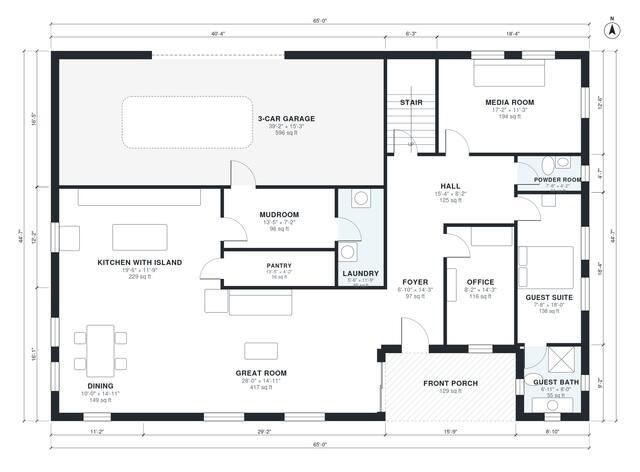

# 4000 Sq Ft House Plans: 5-Bed, 2-Story with 3-Car Garage

A two-story, five-bedroom, 4.5-bath farmhouse of roughly 3,950 sq ft (about 367 m²) of living space, not counting the 3-car garage and porch. The main level has an open kitchen, dining and great room, plus an office, media room, guest suite, mudroom and pantry. Upstairs are the primary suite, three bedrooms, a loft and a laundry room.

| | |
|---|---|
| Levels | 2 |
| Footprint | 19.8 m × 13.6 m (65 ft × 45 ft) |
| Rooms | 26 indoor, 2 outdoor |
| Indoor area including garage, from the room grid | about 448 m² (4,821 sq ft) |

## Files here

- `area-schedule.csv` (room schedule)
- `building.json` (rooms, walls, openings as data)
- `plan-level1.dxf` (floor plan, DXF, drawing units: inches)
- `plan-level2.dxf` (floor plan, DXF, drawing units: inches)

## More for this plan

- Plan page with the PDF plan set, IFC and 3D model, and a tool to change the plan: https://floorplan.ai-architectures.com/house-plans/4000-sq-ft-house-plans?utm_source=github-plans&utm_medium=probe&utm_campaign=github
- PDF plan set: https://storage.googleapis.com/20img/house-plans/4000-sq-ft-house-plans/plan-set.pdf
- IFC model: https://storage.googleapis.com/20img/house-plans/4000-sq-ft-house-plans/model.ifc

## Known issues in this drawing

- Guest Suite is only 2.34 m wide.

Concept design generated with AI. Not for construction or permit; verify with a licensed professional.
