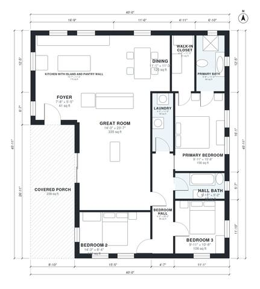

# 40x40 Barndominium Floor Plans: 3 Bed, 2 Bath, 1,600 Sq Ft

This is a one-story, 3-bedroom, 2-bath barndominium with about 1,600 sq ft of living space, plus a roughly 235 sq ft covered porch at the front. A large open great room combines the island kitchen and dining. The three bedrooms, hall bath and laundry sit in a private wing off one hall, with the primary suite at the back and its own bath and walk-in closet.

| | |
|---|---|
| Levels | 1 |
| Footprint | 12.19 m × 13.99 m (40 ft × 46 ft) |
| Rooms | 12 indoor, 1 outdoor |
| Indoor area including garage, from the room grid | about 148 m² (1,597 sq ft) |

## Files here

- `area-schedule.csv` (room schedule)
- `building.json` (rooms, walls, openings as data)
- `plan-level1.dxf` (floor plan, DXF, drawing units: inches)

## More for this plan

- Plan page with the PDF plan set, IFC and 3D model, and a tool to change the plan: https://floorplan.ai-architectures.com/house-plans/40x40-barndominium-floor-plans?utm_source=github-plans&utm_medium=probe&utm_campaign=github
- PDF plan set: https://storage.googleapis.com/20img/house-plans/40x40-barndominium-floor-plans/plan-set.pdf
- IFC model: https://storage.googleapis.com/20img/house-plans/40x40-barndominium-floor-plans/model.ifc

## Known issues in this drawing

- Foyer is 3.8 m² (asked for about 6.0 m²).
- Laundry is only 1.28 m wide.

Concept design generated with AI. Not for construction or permit; verify with a licensed professional.
