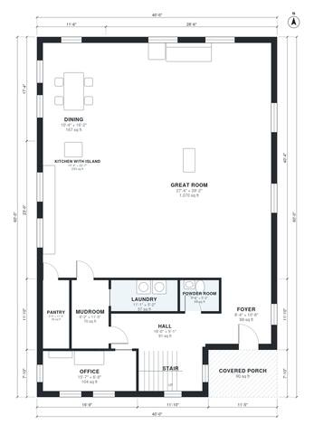

# 40x60 2 Story Barndominium Floor Plans | 4 Bed 4,710 Sq Ft

A two-storey 40 x 60 ft barndominium of about 4,800 sq ft (roughly 446 m²), with an open great room, island kitchen and dining on the ground floor. The covered porch is at the front entry. Upstairs are four bedrooms, a primary suite, a hall bath and a large loft. The revision tightens the plan by compacting the primary suite and merging the loft spaces, and it rebalances the ground-floor areas.

| | |
|---|---|
| Levels | 2 |
| Footprint | 12.19 m × 18.29 m (40 ft × 60 ft) |
| Rooms | 21 indoor, 1 outdoor |
| Indoor area including garage, from the room grid | about 438 m² (4,710 sq ft) |

## Files here

- `area-schedule.csv` (room schedule)
- `building.json` (rooms, walls, openings as data)
- `plan-level1.dxf` (floor plan, DXF, drawing units: inches)
- `plan-level2.dxf` (floor plan, DXF, drawing units: inches)

## More for this plan

- Plan page with the PDF plan set, IFC and 3D model, and a tool to change the plan: https://floorplan.ai-architectures.com/house-plans/40x60-2-story-barndominium-floor-plans?utm_source=github-plans&utm_medium=probe&utm_campaign=github
- PDF plan set: https://storage.googleapis.com/20img/house-plans/40x60-2-story-barndominium-floor-plans/plan-set.pdf
- IFC model: https://storage.googleapis.com/20img/house-plans/40x60-2-story-barndominium-floor-plans/model.ifc

## Known issues in this drawing

- None found by the automatic checks.

Concept design generated with AI. Not for construction or permit; verify with a licensed professional.
