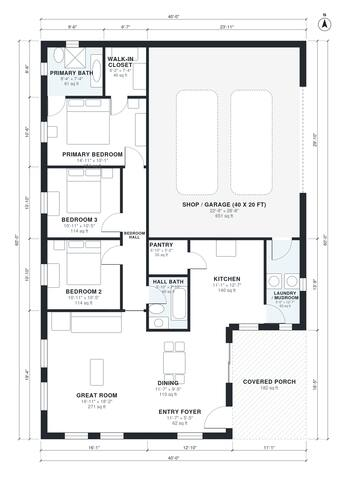

# 40x60 Barndominium Floor Plans: 3 Bed, 2 Bath, 1,500 Sq Ft

A one-story 60 x 40 ft barndominium with a 20 x 40 ft shop/garage at one end and about 1,600 sq ft of living space beside it. The house has an open great room, kitchen and dining, a pantry, a laundry/mudroom that connects to the shop, and a primary suite with bath and walk-in closet. Two more bedrooms and a hall bath sit off a proper bedroom hall. A covered entry porch marks the front door, and a deeper porch can be added outside the rectangle.

| | |
|---|---|
| Levels | 1 |
| Footprint | 12.19 m × 18.29 m (40 ft × 60 ft) |
| Rooms | 14 indoor, 1 outdoor |
| Indoor area including garage, from the room grid | about 206 m² (2,217 sq ft) |

## Files here

- `area-schedule.csv` (room schedule)
- `building.json` (rooms, walls, openings as data)
- `plan-level1.dxf` (floor plan, DXF, drawing units: inches)

## More for this plan

- Plan page with the PDF plan set, IFC and 3D model, and a tool to change the plan: https://floorplan.ai-architectures.com/house-plans/40x60-barndominium-floor-plans?utm_source=github-plans&utm_medium=probe&utm_campaign=github
- PDF plan set: https://storage.googleapis.com/20img/house-plans/40x60-barndominium-floor-plans/plan-set.pdf
- IFC model: https://storage.googleapis.com/20img/house-plans/40x60-barndominium-floor-plans/model.ifc

## Known issues in this drawing

- Primary Bath is 5.7 m² (asked for about 8.0 m²).

Concept design generated with AI. Not for construction or permit; verify with a licensed professional.
