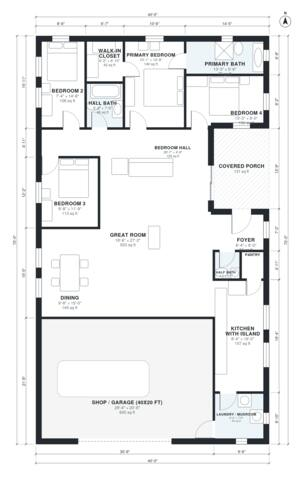

# 40x70 Barndominium Floor Plans: 4 Bed, 2.5 Bath, 2,010 Sq Ft

A single-story 40 x 70 ft barndominium of about 260 m² (2,800 sq ft) including the shop. It has an open great room with kitchen island and dining, a primary suite with ensuite and walk-in closet, three more bedrooms off a private hall, 2.5 baths, laundry/mudroom, and a covered front porch. The revision makes the shop a full-width 40 x 20 ft end bay and widens the laundry, pantry, half bath and closet so they are usable.

| | |
|---|---|
| Levels | 1 |
| Footprint | 12.19 m × 21.34 m (40 ft × 70 ft) |
| Rooms | 16 indoor, 1 outdoor |
| Indoor area including garage, from the room grid | about 248 m² (2,669 sq ft) |

## Files here

- `area-schedule.csv` (room schedule)
- `building.json` (rooms, walls, openings as data)
- `plan-level1.dxf` (floor plan, DXF, drawing units: inches)

## More for this plan

- Plan page with the PDF plan set, IFC and 3D model, and a tool to change the plan: https://floorplan.ai-architectures.com/house-plans/40x70-barndominium-floor-plans?utm_source=github-plans&utm_medium=probe&utm_campaign=github
- PDF plan set: https://storage.googleapis.com/20img/house-plans/40x70-barndominium-floor-plans/plan-set.pdf
- IFC model: https://storage.googleapis.com/20img/house-plans/40x70-barndominium-floor-plans/model.ifc

## Known issues in this drawing

- Covered Porch is not on the street side.
- Half Bath is 1.8 m² (asked for about 3.0 m²).
- Pantry is 1.6 m² (asked for about 3.0 m²).
- Bedroom 2 is only 2.24 m wide.
- Bedroom 4 is only 2.44 m wide.

Concept design generated with AI. Not for construction or permit; verify with a licensed professional.
