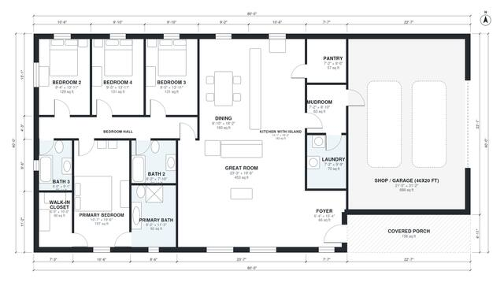

# 40x80 Barndominium Floor Plans: 4 Bed, 3 Bath, 2,300 Sq Ft

This is a one-story, 40x80 ft barndominium of about 297 m² (3,200 sq ft), with roughly 2,400 sq ft of living space plus the shop. The open great room, island kitchen and dining sit in the centre. The four-bedroom wing, with a primary suite and two more baths, is at one end, and the shop and mudroom with its laundry link are at the other. A covered porch marks the front entry.

| | |
|---|---|
| Levels | 1 |
| Footprint | 24.38 m × 12.19 m (80 ft × 40 ft) |
| Rooms | 17 indoor, 1 outdoor |
| Indoor area including garage, from the room grid | about 283 m² (3,043 sq ft) |

## Files here

- `area-schedule.csv` (room schedule)
- `building.json` (rooms, walls, openings as data)
- `plan-level1.dxf` (floor plan, DXF, drawing units: inches)

## More for this plan

- Plan page with the PDF plan set, IFC and 3D model, and a tool to change the plan: https://floorplan.ai-architectures.com/house-plans/40x80-barndominium-floor-plans?utm_source=github-plans&utm_medium=probe&utm_campaign=github
- PDF plan set: https://storage.googleapis.com/20img/house-plans/40x80-barndominium-floor-plans/plan-set.pdf
- IFC model: https://storage.googleapis.com/20img/house-plans/40x80-barndominium-floor-plans/model.ifc

## Known issues in this drawing

- Dining is only 2.68 m wide.

Concept design generated with AI. Not for construction or permit; verify with a licensed professional.
