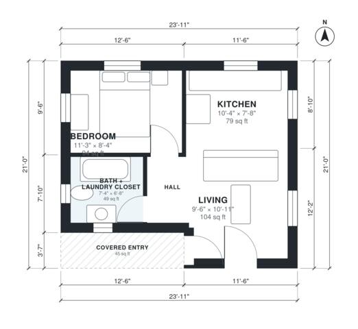

# 450 Sq Ft ADU Plans: 1-Bed, 1-Bath Detached Backyard Unit

This is a compact detached ADU of about 450 sq ft inside, or about 500 sq ft with the covered entry. You enter into an open kitchen and living area. A short hall leads to a private bedroom and a bath with a laundry closet. Every main room has a window, and the layout has no wasted circulation.

| | |
|---|---|
| Levels | 1 |
| Footprint | 7.3 m × 6.4 m (24 ft × 21 ft) |
| Rooms | 5 indoor, 1 outdoor |
| Indoor area including garage, from the room grid | about 43 m² (458 sq ft) |

## Files here

- `area-schedule.csv` (room schedule)
- `building.json` (rooms, walls, openings as data)
- `plan-level1.dxf` (floor plan, DXF, drawing units: inches)

## More for this plan

- Plan page with the PDF plan set, IFC and 3D model, and a tool to change the plan: https://floorplan.ai-architectures.com/house-plans/450-sq-ft-adu-plans?utm_source=github-plans&utm_medium=probe&utm_campaign=github
- PDF plan set: https://storage.googleapis.com/20img/house-plans/450-sq-ft-adu-plans/plan-set.pdf
- IFC model: https://storage.googleapis.com/20img/house-plans/450-sq-ft-adu-plans/model.ifc

## Known issues in this drawing

- Living is 9.7 m² (asked for about 14.0 m²).
- Living is only 2.90 m wide.

Concept design generated with AI. Not for construction or permit; verify with a licensed professional.
