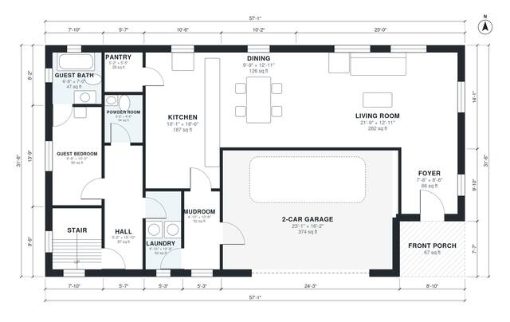

# 5 Bedroom 2 Story House Plans with Basement-Free Layout

A two-storey home of about 260 m² (2,800 sq ft) of living space plus an attached 2-car garage. The ground floor has an open kitchen, dining and living room, a guest bedroom with its own bath, a powder room, a laundry and a mudroom from the garage. Upstairs are the primary suite with bath and walk-in closet, three more bedrooms, a hall bath and a loft. The revision links the hall to the kitchen and makes the guest suite more livable.

| | |
|---|---|
| Levels | 2 |
| Footprint | 17.4 m × 9.6 m (57 ft × 31 ft) |
| Rooms | 23 indoor, 2 outdoor |
| Indoor area including garage, from the room grid | about 297 m² (3,195 sq ft) |

## Files here

- `area-schedule.csv` (room schedule)
- `building.json` (rooms, walls, openings as data)
- `plan-level1.dxf` (floor plan, DXF, drawing units: inches)
- `plan-level2.dxf` (floor plan, DXF, drawing units: inches)

## More for this plan

- Plan page with the PDF plan set, IFC and 3D model, and a tool to change the plan: https://floorplan.ai-architectures.com/house-plans/5-bedroom-2-story-house-plans?utm_source=github-plans&utm_medium=probe&utm_campaign=github
- PDF plan set: https://storage.googleapis.com/20img/house-plans/5-bedroom-2-story-house-plans/plan-set.pdf
- IFC model: https://storage.googleapis.com/20img/house-plans/5-bedroom-2-story-house-plans/model.ifc

## Known issues in this drawing

- Foyer and Hall are not directly connected.
- Guest Bedroom is 8.3 m² (asked for about 13.0 m²).
- Guest Bedroom is only 2.04 m wide.

Concept design generated with AI. Not for construction or permit; verify with a licensed professional.
