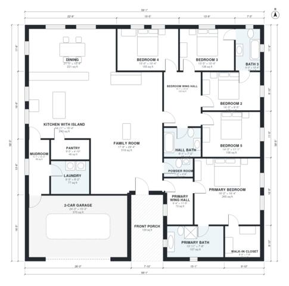

# 5 Bedroom 3 Bath House Plans: 2,890 Sq Ft Single Story

A single-story, five-bedroom, three-bath split-plan ranch of about 270 m² (2,900 sq ft) of living space, plus a 2-car garage and front porch. The primary suite sits in its own wing with a bath and walk-in closet, and four bedrooms share a hall wing on the other side. An open kitchen with island, dining and family room sit at the centre, with the garage entering through a mudroom and laundry next to the kitchen. The revision makes the front porch open straight into the family room and gives the bedrooms more usable width.

| | |
|---|---|
| Levels | 1 |
| Footprint | 18.0 m × 17.8 m (59 ft × 58 ft) |
| Rooms | 19 indoor, 1 outdoor |
| Indoor area including garage, from the room grid | about 308 m² (3,320 sq ft) |

## Files here

- `area-schedule.csv` (room schedule)
- `building.json` (rooms, walls, openings as data)
- `plan-level1.dxf` (floor plan, DXF, drawing units: inches)

## More for this plan

- Plan page with the PDF plan set, IFC and 3D model, and a tool to change the plan: https://floorplan.ai-architectures.com/house-plans/5-bedroom-3-bath-house-plans?utm_source=github-plans&utm_medium=probe&utm_campaign=github
- PDF plan set: https://storage.googleapis.com/20img/house-plans/5-bedroom-3-bath-house-plans/plan-set.pdf
- IFC model: https://storage.googleapis.com/20img/house-plans/5-bedroom-3-bath-house-plans/model.ifc

## Known issues in this drawing

- Family Room has no window.

Concept design generated with AI. Not for construction or permit; verify with a licensed professional.
