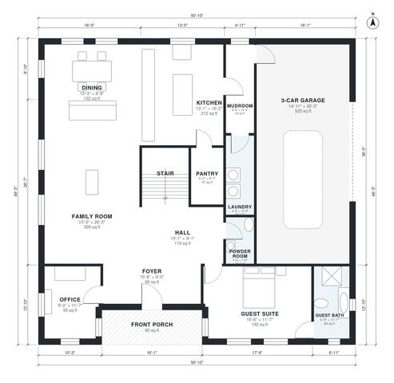

# 5 Bedroom 4 Bath House Plans: 3,520 Sq Ft Two-Story Home

A two-story modern farmhouse with a 3-car garage and a front porch. The ground floor has an open kitchen, dining and family area, an office, a guest suite with its own bath, a mudroom and laundry. Upstairs are the primary suite with bath and walk-in closet, three bedrooms, two baths and a playroom, for about 310-330 m² (3,350-3,550 sq ft) of living space. The revision rebalances the upstairs room sizes so the bedrooms are properly proportioned.

| | |
|---|---|
| Levels | 2 |
| Footprint | 15.5 m × 15.0 m (51 ft × 49 ft) |
| Rooms | 25 indoor, 2 outdoor |
| Indoor area including garage, from the room grid | about 382 m² (4,108 sq ft) |

## Files here

- `area-schedule.csv` (room schedule)
- `building.json` (rooms, walls, openings as data)
- `plan-level1.dxf` (floor plan, DXF, drawing units: inches)
- `plan-level2.dxf` (floor plan, DXF, drawing units: inches)

## More for this plan

- Plan page with the PDF plan set, IFC and 3D model, and a tool to change the plan: https://floorplan.ai-architectures.com/house-plans/5-bedroom-4-bath-house-plans?utm_source=github-plans&utm_medium=probe&utm_campaign=github
- PDF plan set: https://storage.googleapis.com/20img/house-plans/5-bedroom-4-bath-house-plans/plan-set.pdf
- IFC model: https://storage.googleapis.com/20img/house-plans/5-bedroom-4-bath-house-plans/model.ifc

## Known issues in this drawing

- Office is 8.9 m² (asked for about 13.0 m²).
- Playroom is 20.1 m² (asked for about 30.0 m²).
- Bedroom 4 is 10.1 m² (asked for about 15.0 m²).
- Bedroom 4 is only 2.04 m wide.

Concept design generated with AI. Not for construction or permit; verify with a licensed professional.
