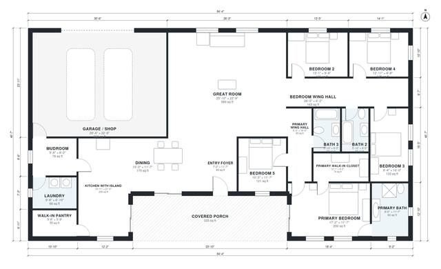

# 5 Bedroom Barndominium Floor Plans: 2,860 Sq Ft Single Story

A single-story barndominium of about 362 m² (3,900 sq ft) overall, with roughly 2,900 sq ft of heated living space. It has five bedrooms and three baths, an open great room, an island kitchen with walk-in pantry, a mudroom and laundry buffering the attached garage/shop, and a covered front porch. The primary suite is in one wing and three bedrooms are in the other. The revision widens those three bedrooms and gives the foyer its full size.

| | |
|---|---|
| Levels | 1 |
| Footprint | 25.7 m × 14.2 m (84 ft × 47 ft) |
| Rooms | 19 indoor, 1 outdoor |
| Indoor area including garage, from the room grid | about 334 m² (3,596 sq ft) |

## Files here

- `area-schedule.csv` (room schedule)
- `building.json` (rooms, walls, openings as data)
- `plan-level1.dxf` (floor plan, DXF, drawing units: inches)

## More for this plan

- Plan page with the PDF plan set, IFC and 3D model, and a tool to change the plan: https://floorplan.ai-architectures.com/house-plans/5-bedroom-barndominium-floor-plans?utm_source=github-plans&utm_medium=probe&utm_campaign=github
- PDF plan set: https://storage.googleapis.com/20img/house-plans/5-bedroom-barndominium-floor-plans/plan-set.pdf
- IFC model: https://storage.googleapis.com/20img/house-plans/5-bedroom-barndominium-floor-plans/model.ifc

## Known issues in this drawing

- None found by the automatic checks.

Concept design generated with AI. Not for construction or permit; verify with a licensed professional.
