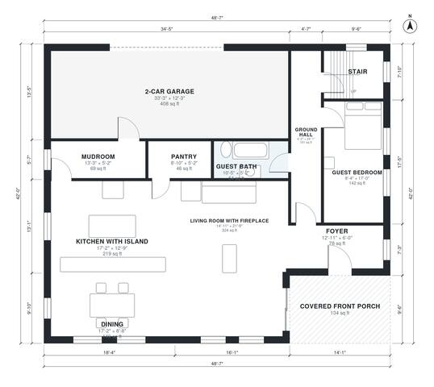

# 5 Bedroom Craftsman House Plans: 2,870 Sq Ft, 2 Story

This is a two-story craftsman home of about 270 m² (roughly 2,900 sq ft) of living space, plus a 2-car garage and a covered front porch. The ground floor has an open living room with a fireplace, a dining area and a kitchen with an island and pantry. It also has a mudroom off the garage and a guest bedroom with its own bath. Upstairs are the primary suite with a walk-in closet and ensuite, three more bedrooms, a hall bath and a laundry room, all off one hall.

| | |
|---|---|
| Levels | 2 |
| Footprint | 14.8 m × 12.8 m (49 ft × 42 ft) |
| Rooms | 21 indoor, 2 outdoor |
| Indoor area including garage, from the room grid | about 310 m² (3,338 sq ft) |

## Files here

- `area-schedule.csv` (room schedule)
- `building.json` (rooms, walls, openings as data)
- `plan-level1.dxf` (floor plan, DXF, drawing units: inches)
- `plan-level2.dxf` (floor plan, DXF, drawing units: inches)

## More for this plan

- Plan page with the PDF plan set, IFC and 3D model, and a tool to change the plan: https://floorplan.ai-architectures.com/house-plans/5-bedroom-craftsman-house-plans?utm_source=github-plans&utm_medium=probe&utm_campaign=github
- PDF plan set: https://storage.googleapis.com/20img/house-plans/5-bedroom-craftsman-house-plans/plan-set.pdf
- IFC model: https://storage.googleapis.com/20img/house-plans/5-bedroom-craftsman-house-plans/model.ifc

## Known issues in this drawing

- None found by the automatic checks.

Concept design generated with AI. Not for construction or permit; verify with a licensed professional.
