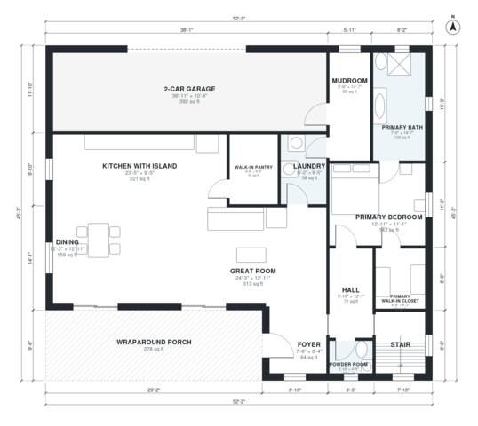

# 5 Bedroom Farmhouse Plans: 3,060 Sq Ft Two-Story with Porch

A two-story modern farmhouse with a ground-floor primary suite (bedroom, bath and walk-in closet). The open kitchen with island and walk-in pantry runs into the dining area and great room, which open onto a front porch. Upstairs are four bedrooms, two baths and a bonus room. The attached 2-car garage enters through the mudroom and the kitchen. Living space is about 3,200 sq ft, not counting the garage or porch.

| | |
|---|---|
| Levels | 2 |
| Footprint | 15.9 m × 13.8 m (52 ft × 45 ft) |
| Rooms | 23 indoor, 2 outdoor |
| Indoor area including garage, from the room grid | about 326 m² (3,505 sq ft) |

## Files here

- `area-schedule.csv` (room schedule)
- `building.json` (rooms, walls, openings as data)
- `plan-level1.dxf` (floor plan, DXF, drawing units: inches)
- `plan-level2.dxf` (floor plan, DXF, drawing units: inches)

## More for this plan

- Plan page with the PDF plan set, IFC and 3D model, and a tool to change the plan: https://floorplan.ai-architectures.com/house-plans/5-bedroom-farmhouse-plans?utm_source=github-plans&utm_medium=probe&utm_campaign=github
- PDF plan set: https://storage.googleapis.com/20img/house-plans/5-bedroom-farmhouse-plans/plan-set.pdf
- IFC model: https://storage.googleapis.com/20img/house-plans/5-bedroom-farmhouse-plans/model.ifc

## Known issues in this drawing

- Foyer is 5.9 m² (asked for about 8.0 m²).
- Primary Bedroom is 13.3 m² (asked for about 19.0 m²).
- Bedroom 2 is only 2.54 m wide.

Concept design generated with AI. Not for construction or permit; verify with a licensed professional.
