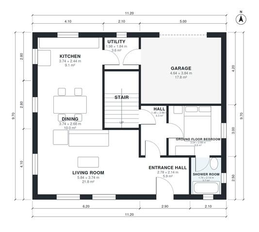

# 5 Bedroom House Plan 170 m2: 1,850 Sq Ft, 2-Story with Garage

This is a compact two-storey family house of about 175 m² of living space on an 11.2 x 9.7 m footprint, plus an attached 1-car garage. The ground floor has an open kitchen, dining and living area, a utility room, and a bedroom with its own shower room. Upstairs, the primary suite with ensuite and walk-in closet, three more bedrooms and a family bath all open off a central landing.

| | |
|---|---|
| Levels | 2 |
| Footprint | 11.2 m × 9.7 m (37 ft × 32 ft) |
| Rooms | 19 indoor, 1 outdoor |
| Indoor area including garage, from the room grid | about 193 m² (2,074 sq ft) |

## Files here

- `area-schedule.csv` (room schedule)
- `building.json` (rooms, walls, openings as data)
- `plan-level1.dxf` (floor plan, DXF, drawing units: millimetres)
- `plan-level2.dxf` (floor plan, DXF, drawing units: millimetres)

## More for this plan

- Plan page with the PDF plan set, IFC and 3D model, and a tool to change the plan: https://floorplan.ai-architectures.com/house-plans/5-bedroom-house-plan-170-m2?utm_source=github-plans&utm_medium=probe&utm_campaign=github
- PDF plan set: https://storage.googleapis.com/20img/house-plans/5-bedroom-house-plan-170-m2/plan-set.pdf
- IFC model: https://storage.googleapis.com/20img/house-plans/5-bedroom-house-plan-170-m2/model.ifc

## Known issues in this drawing

- None found by the automatic checks.

Concept design generated with AI. Not for construction or permit; verify with a licensed professional.
