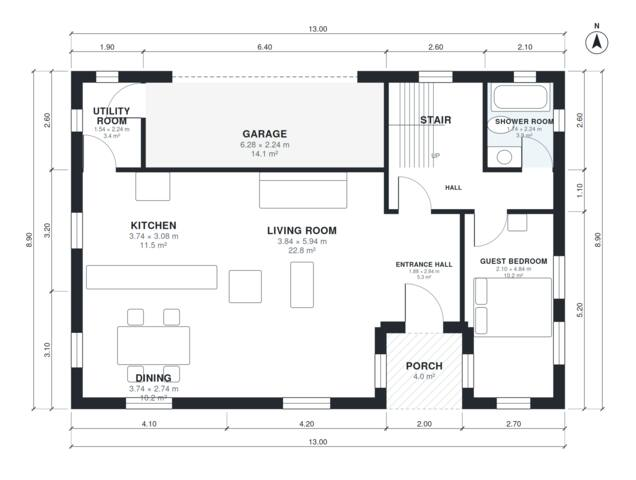

# 5 Bedroom House Plan 185 m2: 1,980 Sq Ft, 2 Story, 3 Bath

A compact two-storey house of roughly 185 m² of living space plus a 1-car garage. The ground floor has an open kitchen, dining and living area, a guest bedroom, a shower room and a utility room that links to the garage. Upstairs are the primary suite with walk-in closet and ensuite, three more bedrooms, a family bath and a terrace.

| | |
|---|---|
| Levels | 2 |
| Footprint | 13.0 m × 8.9 m (43 ft × 29 ft) |
| Rooms | 19 indoor, 2 outdoor |
| Indoor area including garage, from the room grid | about 201 m² (2,160 sq ft) |

## Files here

- `area-schedule.csv` (room schedule)
- `building.json` (rooms, walls, openings as data)
- `plan-level1.dxf` (floor plan, DXF, drawing units: millimetres)
- `plan-level2.dxf` (floor plan, DXF, drawing units: millimetres)

## More for this plan

- Plan page with the PDF plan set, IFC and 3D model, and a tool to change the plan: https://floorplan.ai-architectures.com/house-plans/5-bedroom-house-plan-185-m2?utm_source=github-plans&utm_medium=probe&utm_campaign=github
- PDF plan set: https://storage.googleapis.com/20img/house-plans/5-bedroom-house-plan-185-m2/plan-set.pdf
- IFC model: https://storage.googleapis.com/20img/house-plans/5-bedroom-house-plan-185-m2/model.ifc

## Known issues in this drawing

- Guest Bedroom is only 2.10 m wide.
- Utility Room is 3.4 m² (asked for about 5.0 m²).
- Garage is 14.1 m² (asked for about 21.0 m²).
- Garage is only 2.24 m wide.
- Walk-in Closet is 3.9 m² (asked for about 5.5 m²).

Concept design generated with AI. Not for construction or permit; verify with a licensed professional.
