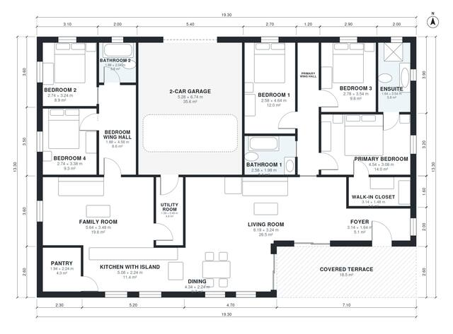

# 5 Bedroom House Plan 200 m2: 2,150 Sq Ft Single Story

A single-storey house of about 200 m² of living space on a 19.3 x 13.3 m footprint, plus the garage and covered terrace. The open kitchen with island and pantry, dining, living and family rooms sit at the centre. The primary suite with ensuite and walk-in closet is in the east wing, with Bedrooms 1 and 3. Bedrooms 2 and 4 and a bath are in the west wing, on either side of the 2-car garage. The garage connects through the utility room, and the terrace opens from the living and dining areas.

| | |
|---|---|
| Levels | 1 |
| Footprint | 19.3 m × 13.3 m (63 ft × 44 ft) |
| Rooms | 19 indoor, 1 outdoor |
| Indoor area including garage, from the room grid | about 238 m² (2,564 sq ft) |

## Files here

- `area-schedule.csv` (room schedule)
- `building.json` (rooms, walls, openings as data)
- `plan-level1.dxf` (floor plan, DXF, drawing units: millimetres)

## More for this plan

- Plan page with the PDF plan set, IFC and 3D model, and a tool to change the plan: https://floorplan.ai-architectures.com/house-plans/5-bedroom-house-plan-200-m2?utm_source=github-plans&utm_medium=probe&utm_campaign=github
- PDF plan set: https://storage.googleapis.com/20img/house-plans/5-bedroom-house-plan-200-m2/plan-set.pdf
- IFC model: https://storage.googleapis.com/20img/house-plans/5-bedroom-house-plan-200-m2/model.ifc

## Known issues in this drawing

- Dining is only 2.24 m wide.

Concept design generated with AI. Not for construction or permit; verify with a licensed professional.
