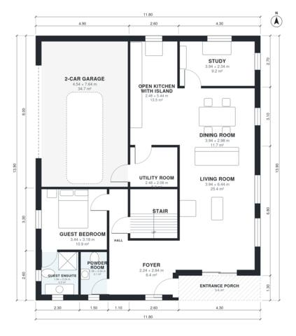

# 5 Bedroom House Plan 230 m2: 2,510 Sq Ft Two-Story + Garage

A two-storey contemporary house of about 224 m² of living space, plus a 38 m² attached 2-car garage. The ground floor has an open kitchen, dining and living area, a study off the entry, a utility room and a guest suite. Upstairs are the primary suite with a dressing room, three more bedrooms and a shared bath.

| | |
|---|---|
| Levels | 2 |
| Footprint | 11.8 m × 13.9 m (39 ft × 46 ft) |
| Rooms | 21 indoor, 2 outdoor |
| Indoor area including garage, from the room grid | about 272 m² (2,928 sq ft) |

## Files here

- `area-schedule.csv` (room schedule)
- `building.json` (rooms, walls, openings as data)
- `plan-level1.dxf` (floor plan, DXF, drawing units: millimetres)
- `plan-level2.dxf` (floor plan, DXF, drawing units: millimetres)

## More for this plan

- Plan page with the PDF plan set, IFC and 3D model, and a tool to change the plan: https://floorplan.ai-architectures.com/house-plans/5-bedroom-house-plan-230-m2?utm_source=github-plans&utm_medium=probe&utm_campaign=github
- PDF plan set: https://storage.googleapis.com/20img/house-plans/5-bedroom-house-plan-230-m2/plan-set.pdf
- IFC model: https://storage.googleapis.com/20img/house-plans/5-bedroom-house-plan-230-m2/model.ifc

## Known issues in this drawing

- Hall and Study are not directly connected.

Concept design generated with AI. Not for construction or permit; verify with a licensed professional.
