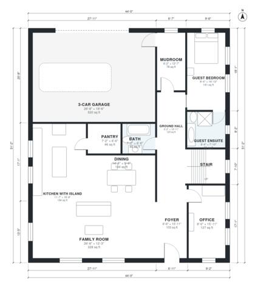

# 5 Bedroom House Plans with 3 Car Garage - 3,320 Sq Ft Plan

A two-story 5-bedroom, 4-bath farmhouse of about 300 m² (roughly 3,300 sq ft) of living space, plus an attached 3-car garage. The ground floor has an open kitchen, dining and family room, an office, a mudroom and a guest suite. Upstairs are the primary suite, three bedrooms, a hall bath, laundry and a loft that opens onto a roof deck above the garage.

| | |
|---|---|
| Levels | 2 |
| Footprint | 13.4 m × 15.6 m (44 ft × 51 ft) |
| Rooms | 24 indoor, 1 outdoor |
| Indoor area including garage, from the room grid | about 362 m² (3,898 sq ft) |

## Files here

- `area-schedule.csv` (room schedule)
- `building.json` (rooms, walls, openings as data)
- `plan-level1.dxf` (floor plan, DXF, drawing units: inches)
- `plan-level2.dxf` (floor plan, DXF, drawing units: inches)

## More for this plan

- Plan page with the PDF plan set, IFC and 3D model, and a tool to change the plan: https://floorplan.ai-architectures.com/house-plans/5-bedroom-house-plans-with-3-car-garage?utm_source=github-plans&utm_medium=probe&utm_campaign=github
- PDF plan set: https://storage.googleapis.com/20img/house-plans/5-bedroom-house-plans-with-3-car-garage/plan-set.pdf
- IFC model: https://storage.googleapis.com/20img/house-plans/5-bedroom-house-plans-with-3-car-garage/model.ifc

## Known issues in this drawing

- Dining has no window.
- Office is only 2.44 m wide.
- Primary Bath is 7.9 m² (asked for about 11.0 m²).

Concept design generated with AI. Not for construction or permit; verify with a licensed professional.
