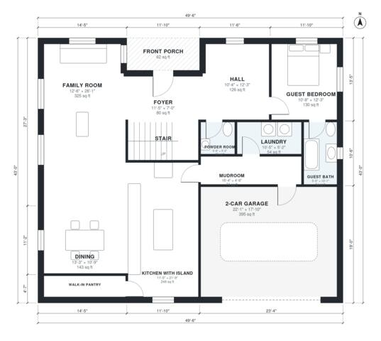

# 5 Bedroom House Plans: 3,130 Sq Ft Two-Story With Garage

This is a two-story modern farmhouse of about 3,130 sq ft of living space plus a 2-car garage. Downstairs has an open kitchen with island and walk-in pantry, a family room, dining, a powder room, a laundry/mudroom route to the garage, and a guest bedroom with its own full bath. Upstairs, the primary suite has a walk-in closet and ensuite. Three more bedrooms, a hall bath and a family loft open off a central hall by the stair.

| | |
|---|---|
| Levels | 2 |
| Footprint | 15.1 m × 13.1 m (50 ft × 43 ft) |
| Rooms | 24 indoor, 2 outdoor |
| Indoor area including garage, from the room grid | about 332 m² (3,576 sq ft) |

## Files here

- `area-schedule.csv` (room schedule)
- `building.json` (rooms, walls, openings as data)
- `plan-level1.dxf` (floor plan, DXF, drawing units: inches)
- `plan-level2.dxf` (floor plan, DXF, drawing units: inches)

## More for this plan

- Plan page with the PDF plan set, IFC and 3D model, and a tool to change the plan: https://floorplan.ai-architectures.com/house-plans/5-bedroom-house-plans?utm_source=github-plans&utm_medium=probe&utm_campaign=github
- PDF plan set: https://storage.googleapis.com/20img/house-plans/5-bedroom-house-plans/plan-set.pdf
- IFC model: https://storage.googleapis.com/20img/house-plans/5-bedroom-house-plans/model.ifc

## Known issues in this drawing

- Front Porch is not on the street side.
- Foyer is 7.4 m² (asked for about 10.0 m²).

Concept design generated with AI. Not for construction or permit; verify with a licensed professional.
