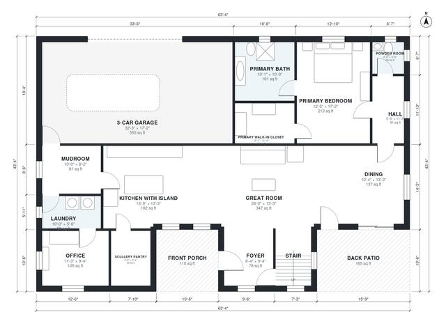

# 5 Bedroom Modern Farmhouse Plans: 3,270 Sq Ft, 2 Story

This two-storey modern farmhouse has about 3,400 sq ft (316 m²) of living space plus a three-car garage. The ground floor has an open great room, island kitchen, scullery pantry, dining room, office, mudroom and a private primary suite. Upstairs are four bedrooms, two baths and a large bonus room off a central hall.

| | |
|---|---|
| Levels | 2 |
| Footprint | 19.3 m × 13.2 m (63 ft × 43 ft) |
| Rooms | 25 indoor, 3 outdoor |
| Indoor area including garage, from the room grid | about 361 m² (3,887 sq ft) |

## Files here

- `area-schedule.csv` (room schedule)
- `building.json` (rooms, walls, openings as data)
- `plan-level1.dxf` (floor plan, DXF, drawing units: inches)
- `plan-level2.dxf` (floor plan, DXF, drawing units: inches)

## More for this plan

- Plan page with the PDF plan set, IFC and 3D model, and a tool to change the plan: https://floorplan.ai-architectures.com/house-plans/5-bedroom-modern-farmhouse-plans?utm_source=github-plans&utm_medium=probe&utm_campaign=github
- PDF plan set: https://storage.googleapis.com/20img/house-plans/5-bedroom-modern-farmhouse-plans/plan-set.pdf
- IFC model: https://storage.googleapis.com/20img/house-plans/5-bedroom-modern-farmhouse-plans/model.ifc

## Known issues in this drawing

- Foyer and Office are not directly connected.
- Mudroom and Hall are not directly connected.

Concept design generated with AI. Not for construction or permit; verify with a licensed professional.
