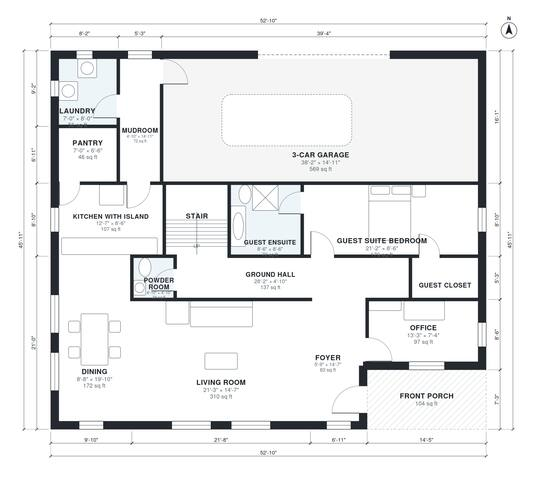

# 5 Bedroom Modern House Plans: 3,340 Sq Ft, 3-Car Garage

A two-story modern home of about 3,550 sq ft of living space, plus an attached 3-car garage and a front porch. The ground floor has an open kitchen, dining and living area with an island, an office, a mudroom, a pantry and a guest suite. Upstairs are the primary suite with a walk-in closet, three more bedrooms and a large loft. The laundry now opens off the ground-floor hall beside the stair.

| | |
|---|---|
| Levels | 2 |
| Footprint | 16.1 m × 14.0 m (53 ft × 46 ft) |
| Rooms | 27 indoor, 2 outdoor |
| Indoor area including garage, from the room grid | about 369 m² (3,971 sq ft) |

## Files here

- `area-schedule.csv` (room schedule)
- `building.json` (rooms, walls, openings as data)
- `plan-level1.dxf` (floor plan, DXF, drawing units: inches)
- `plan-level2.dxf` (floor plan, DXF, drawing units: inches)

## More for this plan

- Plan page with the PDF plan set, IFC and 3D model, and a tool to change the plan: https://floorplan.ai-architectures.com/house-plans/5-bedroom-modern-house-plans?utm_source=github-plans&utm_medium=probe&utm_campaign=github
- PDF plan set: https://storage.googleapis.com/20img/house-plans/5-bedroom-modern-house-plans/plan-set.pdf
- IFC model: https://storage.googleapis.com/20img/house-plans/5-bedroom-modern-house-plans/model.ifc

## Known issues in this drawing

- Powder Room is 2.2 m² (asked for about 3.0 m²).
- Kitchen with Island is 9.9 m² (asked for about 20.0 m²).

Concept design generated with AI. Not for construction or permit; verify with a licensed professional.
