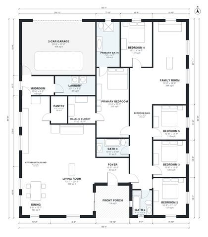

# 5 Bedroom One Story House Plans: 2,990 Sq Ft Ranch Layout

This is a single-story, five-bedroom, three-bath home of roughly 278 m² (about 3,000 sq ft) of living space. It sits in a rectangular footprint of about 64 ft by 56 ft, plus an attached 2-car garage and a front porch. The open kitchen with island, dining and living area runs along the front and right side of the house. The primary suite is at the front, and the other four bedrooms and the family room are in the rear wing. The garage connects through a mudroom and laundry.

| | |
|---|---|
| Levels | 1 |
| Footprint | 16.8 m × 19.7 m (55 ft × 65 ft) |
| Rooms | 19 indoor, 1 outdoor |
| Indoor area including garage, from the room grid | about 320 m² (3,449 sq ft) |

## Files here

- `area-schedule.csv` (room schedule)
- `building.json` (rooms, walls, openings as data)
- `plan-level1.dxf` (floor plan, DXF, drawing units: inches)

## More for this plan

- Plan page with the PDF plan set, IFC and 3D model, and a tool to change the plan: https://floorplan.ai-architectures.com/house-plans/5-bedroom-one-story-house-plans?utm_source=github-plans&utm_medium=probe&utm_campaign=github
- PDF plan set: https://storage.googleapis.com/20img/house-plans/5-bedroom-one-story-house-plans/plan-set.pdf
- IFC model: https://storage.googleapis.com/20img/house-plans/5-bedroom-one-story-house-plans/model.ifc

## Known issues in this drawing

- Primary Bedroom has no window.
- Primary Bedroom needs an egress window (min. 0.53 m² / 5.7 sq ft opening).

Concept design generated with AI. Not for construction or permit; verify with a licensed professional.
