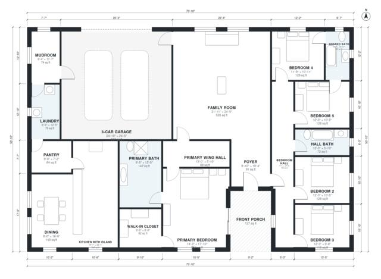

# 5 Bedroom Ranch House Plans: 2,980 Sq Ft, 3-Car Garage

A single-story split-plan ranch of roughly 268 m² (about 2,900 sq ft) of living space, plus a 3-car garage and a front porch. The primary suite is in its own wing. The four other bedrooms are off a hall on the opposite side of an open kitchen, dining and family core. The revision gives the garage a proper 3-car width and routes it through the mudroom into the kitchen. It also widens the dining room and trims the oversized primary suite and family room.

| | |
|---|---|
| Levels | 1 |
| Footprint | 22.5 m × 15.5 m (74 ft × 51 ft) |
| Rooms | 19 indoor, 1 outdoor |
| Indoor area including garage, from the room grid | about 337 m² (3,627 sq ft) |

## Files here

- `area-schedule.csv` (room schedule)
- `building.json` (rooms, walls, openings as data)
- `plan-level1.dxf` (floor plan, DXF, drawing units: inches)

## More for this plan

- Plan page with the PDF plan set, IFC and 3D model, and a tool to change the plan: https://floorplan.ai-architectures.com/house-plans/5-bedroom-ranch-house-plans?utm_source=github-plans&utm_medium=probe&utm_campaign=github
- PDF plan set: https://storage.googleapis.com/20img/house-plans/5-bedroom-ranch-house-plans/plan-set.pdf
- IFC model: https://storage.googleapis.com/20img/house-plans/5-bedroom-ranch-house-plans/model.ifc

## Known issues in this drawing

- None found by the automatic checks.

Concept design generated with AI. Not for construction or permit; verify with a licensed professional.
