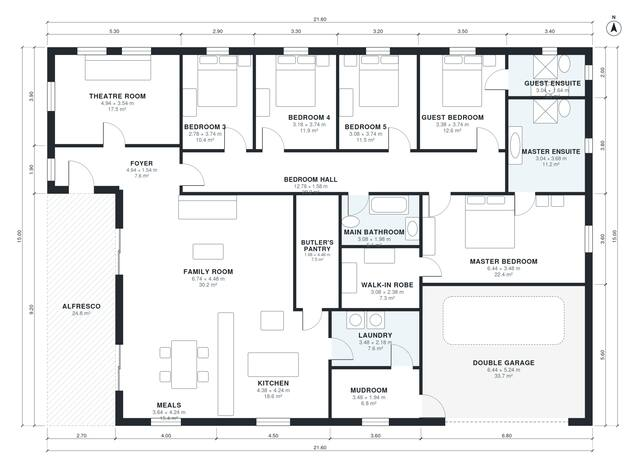

# 5 Bedroom Single Storey House Plans | 2,810 Sq Ft, 3 Bath

This is a single-storey, 5-bedroom home of about 260 m² of living space, with a 38 m² double garage and a 25 m² alfresco on top of that. The open kitchen, meals and family area opens onto the alfresco, and a butler's pantry sits beside the kitchen. The master suite has a walk-in robe and ensuite, the guest bedroom has its own ensuite, and the theatre room sits just off the foyer. The remaining three bedrooms share a main bathroom off a bedroom hall.

| | |
|---|---|
| Levels | 1 |
| Footprint | 21.6 m × 15.0 m (71 ft × 49 ft) |
| Rooms | 19 indoor, 1 outdoor |
| Indoor area including garage, from the room grid | about 299 m² (3,220 sq ft) |

## Files here

- `area-schedule.csv` (room schedule)
- `building.json` (rooms, walls, openings as data)
- `plan-level1.dxf` (floor plan, DXF, drawing units: millimetres)

## More for this plan

- Plan page with the PDF plan set, IFC and 3D model, and a tool to change the plan: https://floorplan.ai-architectures.com/house-plans/5-bedroom-single-storey-house-plans?utm_source=github-plans&utm_medium=probe&utm_campaign=github
- PDF plan set: https://storage.googleapis.com/20img/house-plans/5-bedroom-single-storey-house-plans/plan-set.pdf
- IFC model: https://storage.googleapis.com/20img/house-plans/5-bedroom-single-storey-house-plans/model.ifc

## Known issues in this drawing

- None found by the automatic checks.

Concept design generated with AI. Not for construction or permit; verify with a licensed professional.
