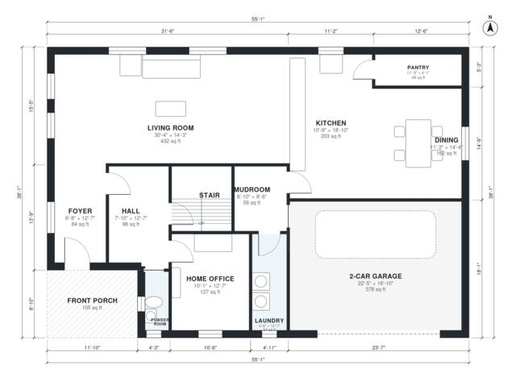

# 5 Bedroom Two Story House Plans: 3,310 Sq Ft, 3.5 Baths

This two-storey modern farmhouse has about 312 m² (3,350 sq ft) of living space plus an attached 2-car garage and a front porch. The ground floor has a large open kitchen, dining and living area, a home office, powder room, pantry, mudroom and laundry. Upstairs, five bedrooms open off a central hall, including a primary suite with a bath and walk-in closet, and there are two more bathrooms.

| | |
|---|---|
| Levels | 2 |
| Footprint | 16.8 m × 11.6 m (55 ft × 38 ft) |
| Rooms | 23 indoor, 2 outdoor |
| Indoor area including garage, from the room grid | about 347 m² (3,737 sq ft) |

## Files here

- `area-schedule.csv` (room schedule)
- `building.json` (rooms, walls, openings as data)
- `plan-level1.dxf` (floor plan, DXF, drawing units: inches)
- `plan-level2.dxf` (floor plan, DXF, drawing units: inches)

## More for this plan

- Plan page with the PDF plan set, IFC and 3D model, and a tool to change the plan: https://floorplan.ai-architectures.com/house-plans/5-bedroom-two-story-house-plans?utm_source=github-plans&utm_medium=probe&utm_campaign=github
- PDF plan set: https://storage.googleapis.com/20img/house-plans/5-bedroom-two-story-house-plans/plan-set.pdf
- IFC model: https://storage.googleapis.com/20img/house-plans/5-bedroom-two-story-house-plans/model.ifc

## Known issues in this drawing

- Powder Room is 2.2 m² (asked for about 3.5 m²).
- Powder Room is only 0.94 m wide.

Concept design generated with AI. Not for construction or permit; verify with a licensed professional.
