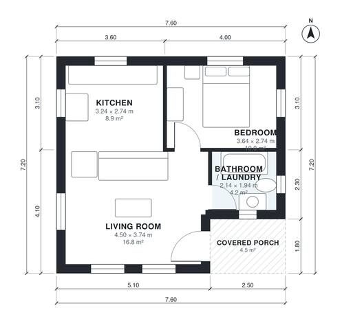

# 50 Square Meter House Plans: 540 Sq Ft, 1 Bed, 1 Bath

A compact one-bedroom cottage of about 50 m² indoors (roughly 540 sq ft), plus a small covered front porch, with no garage. An open kitchen and living area is the centre of the plan, with the bedroom and bathroom off it. The laundry moves into the bathroom so each room gets a more workable shape.

| | |
|---|---|
| Levels | 1 |
| Footprint | 7.6 m × 7.2 m (25 ft × 24 ft) |
| Rooms | 4 indoor, 1 outdoor |
| Indoor area including garage, from the room grid | about 50 m² (541 sq ft) |

## Files here

- `area-schedule.csv` (room schedule)
- `building.json` (rooms, walls, openings as data)
- `plan-level1.dxf` (floor plan, DXF, drawing units: millimetres)

## More for this plan

- Plan page with the PDF plan set, IFC and 3D model, and a tool to change the plan: https://floorplan.ai-architectures.com/house-plans/50-square-meter-house-plans?utm_source=github-plans&utm_medium=probe&utm_campaign=github
- PDF plan set: https://storage.googleapis.com/20img/house-plans/50-square-meter-house-plans/plan-set.pdf
- IFC model: https://storage.googleapis.com/20img/house-plans/50-square-meter-house-plans/model.ifc

## Known issues in this drawing

- Bedroom is only 2.74 m wide.

Concept design generated with AI. Not for construction or permit; verify with a licensed professional.
