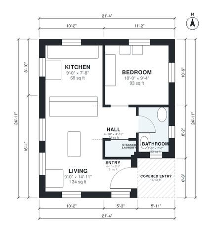

# 500 Sq Ft ADU Plans: 1 Bed, 1 Bath Backyard Cottage Layout

This is a compact one-bedroom, one-bath backyard ADU of about 494 sq ft inside, plus a 37 sq ft covered entry. A covered porch leads into an open kitchen and living area with plenty of windows. A small hall serves the private corner bedroom, the full bath and a stacked washer/dryer closet.

| | |
|---|---|
| Levels | 1 |
| Footprint | 6.5 m × 7.6 m (21 ft × 25 ft) |
| Rooms | 7 indoor, 1 outdoor |
| Indoor area including garage, from the room grid | about 46 m² (495 sq ft) |

## Files here

- `building.json` (rooms, walls, openings as data)
- `plan-level1.dxf` (floor plan, DXF, drawing units: inches)

## More for this plan

- Plan page with the PDF plan set, IFC and 3D model, and a tool to change the plan: https://floorplan.ai-architectures.com/house-plans/500-sq-ft-adu-plans?utm_source=github-plans&utm_medium=probe&utm_campaign=github
- PDF plan set: https://storage.googleapis.com/20img/house-plans/500-sq-ft-adu-plans/plan-set.pdf
- IFC model: https://storage.googleapis.com/20img/house-plans/500-sq-ft-adu-plans/model.ifc

## Known issues in this drawing

- Living is only 2.74 m wide.
- Entry is 1.9 m² (asked for about 3.0 m²).
- Bathroom is 3.1 m² (asked for about 4.5 m²).

Concept design generated with AI. Not for construction or permit; verify with a licensed professional.
