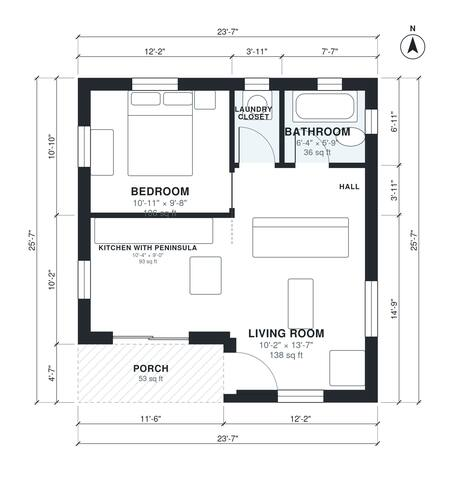

# 550 Sq Ft ADU Plans: 1 Bed, 1 Bath Detached Backyard ADU

This is a compact detached 1-bedroom backyard ADU of about 51 m² (550 sq ft) indoors, plus a 5 m² front porch. You enter from the porch into an open living and kitchen area with a peninsula. A short hall leads to the bedroom, a full bath with a tub and a laundry closet along the back wall. The layout is efficient and private, with windows in the bedroom, bath, kitchen and living areas.

| | |
|---|---|
| Levels | 1 |
| Footprint | 7.2 m × 7.8 m (24 ft × 26 ft) |
| Rooms | 6 indoor, 1 outdoor |
| Indoor area including garage, from the room grid | about 51 m² (552 sq ft) |

## Files here

- `area-schedule.csv` (room schedule)
- `building.json` (rooms, walls, openings as data)
- `plan-level1.dxf` (floor plan, DXF, drawing units: inches)

## More for this plan

- Plan page with the PDF plan set, IFC and 3D model, and a tool to change the plan: https://floorplan.ai-architectures.com/house-plans/550-sq-ft-adu-plans?utm_source=github-plans&utm_medium=probe&utm_campaign=github
- PDF plan set: https://storage.googleapis.com/20img/house-plans/550-sq-ft-adu-plans/plan-set.pdf
- IFC model: https://storage.googleapis.com/20img/house-plans/550-sq-ft-adu-plans/model.ifc

## Known issues in this drawing

- Living Room is only 3.10 m wide.

Concept design generated with AI. Not for construction or permit; verify with a licensed professional.
