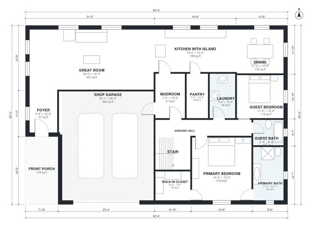

# 6 Bedroom Barndominium Floor Plans: 3,360 Sq Ft, Two-Story

This two-story barndominium has about 323 m² (roughly 3,480 sq ft) of living space plus a 60 m² attached shop garage and a front porch. The ground floor has an open great room, kitchen with island and pantry, dining, a primary suite with bath and walk-in closet, a guest bedroom and bath, laundry and a mudroom that links the garage to the kitchen. Upstairs, a central hall serves four bedrooms, two baths and a loft.

| | |
|---|---|
| Levels | 2 |
| Footprint | 19.3 m × 13.2 m (63 ft × 43 ft) |
| Rooms | 24 indoor, 2 outdoor |
| Indoor area including garage, from the room grid | about 372 m² (4,005 sq ft) |

## Files here

- `area-schedule.csv` (room schedule)
- `building.json` (rooms, walls, openings as data)
- `plan-level1.dxf` (floor plan, DXF, drawing units: inches)
- `plan-level2.dxf` (floor plan, DXF, drawing units: inches)

## More for this plan

- Plan page with the PDF plan set, IFC and 3D model, and a tool to change the plan: https://floorplan.ai-architectures.com/house-plans/6-bedroom-barndominium-floor-plans?utm_source=github-plans&utm_medium=probe&utm_campaign=github
- PDF plan set: https://storage.googleapis.com/20img/house-plans/6-bedroom-barndominium-floor-plans/plan-set.pdf
- IFC model: https://storage.googleapis.com/20img/house-plans/6-bedroom-barndominium-floor-plans/model.ifc

## Known issues in this drawing

- Loft is 25.9 m² (asked for about 40.0 m²).
- Upper Bath 1 is 5.0 m² (asked for about 8.0 m²).
- Bedroom 4 is only 2.34 m wide.

Concept design generated with AI. Not for construction or permit; verify with a licensed professional.
