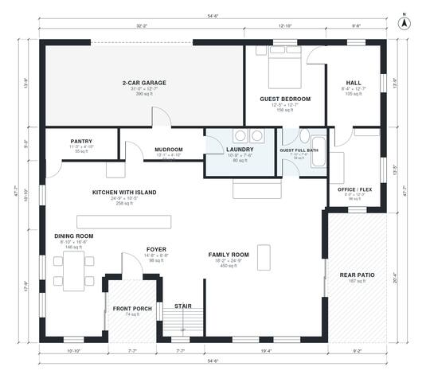

# 6 Bedroom House Plans: 3,740 Sq Ft Two-Story Family Home

This is a two-story modern farmhouse with about 3,640 sq ft of living space plus a 2-car garage, close to your 3,700 sq ft target. The ground floor has an open kitchen with island flowing into the dining and family rooms, a guest suite with full bath, an office, a pantry and a mudroom-laundry zone off the garage. Upstairs, the primary suite has a walk-in closet and ensuite, four more bedrooms share two hall baths, and a family loft sits at the center. We can fine-tune the small rooms and add windows to the dining room and kitchen if you like.

| | |
|---|---|
| Levels | 2 |
| Footprint | 16.6 m × 14.5 m (54 ft × 48 ft) |
| Rooms | 26 indoor, 3 outdoor |
| Indoor area including garage, from the room grid | about 389 m² (4,183 sq ft) |

## Files here

- `area-schedule.csv` (room schedule)
- `building.json` (rooms, walls, openings as data)
- `plan-level1.dxf` (floor plan, DXF, drawing units: inches)
- `plan-level2.dxf` (floor plan, DXF, drawing units: inches)

## More for this plan

- Plan page with the PDF plan set, IFC and 3D model, and a tool to change the plan: https://floorplan.ai-architectures.com/house-plans/6-bedroom-house-plans?utm_source=github-plans&utm_medium=probe&utm_campaign=github
- PDF plan set: https://storage.googleapis.com/20img/house-plans/6-bedroom-house-plans/plan-set.pdf
- IFC model: https://storage.googleapis.com/20img/house-plans/6-bedroom-house-plans/model.ifc

## Known issues in this drawing

- Kitchen with Island is only 3.18 m wide.
- Bedroom 5 is only 2.30 m wide.

Concept design generated with AI. Not for construction or permit; verify with a licensed professional.
