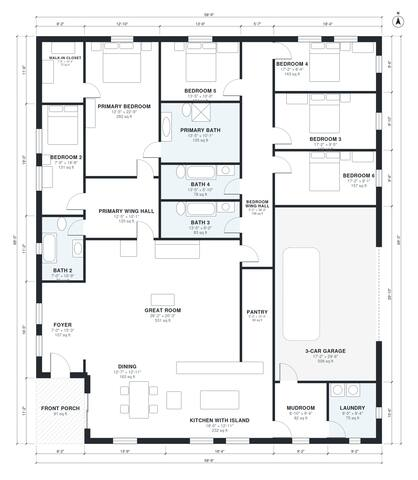

# 6 Bedroom One Story House Plans: 3,430 Sq Ft with 3-Car Garage

A single-story split-wing ranch of about 317 m² (3,400 sq ft) of living space, plus a 3-car garage and a front porch. The primary suite and one bedroom sit on one side of a large open great room, kitchen and dining area. Four bedrooms and two baths sit in the other wing, with the garage, mudroom and laundry at the back. The rear patio opens off the great room and dining room.

| | |
|---|---|
| Levels | 1 |
| Footprint | 17.9 m × 21.1 m (59 ft × 69 ft) |
| Rooms | 21 indoor, 1 outdoor |
| Indoor area including garage, from the room grid | about 369 m² (3,974 sq ft) |

## Files here

- `area-schedule.csv` (room schedule)
- `building.json` (rooms, walls, openings as data)
- `plan-level1.dxf` (floor plan, DXF, drawing units: inches)

## More for this plan

- Plan page with the PDF plan set, IFC and 3D model, and a tool to change the plan: https://floorplan.ai-architectures.com/house-plans/6-bedroom-one-story-house-plans?utm_source=github-plans&utm_medium=probe&utm_campaign=github
- PDF plan set: https://storage.googleapis.com/20img/house-plans/6-bedroom-one-story-house-plans/plan-set.pdf
- IFC model: https://storage.googleapis.com/20img/house-plans/6-bedroom-one-story-house-plans/model.ifc

## Known issues in this drawing

- Bedroom 2 is only 2.14 m wide.
- Walk-in Closet is 6.7 m² (asked for about 9.0 m²).
- Great Room has no window.

Concept design generated with AI. Not for construction or permit; verify with a licensed professional.
