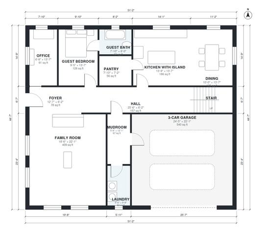

# 6 Bedroom Two Story House Plans: 3,520 Sq Ft, 3-Car Garage

This two-story modern farmhouse has about 335 m² (3,600 sq ft) of living space plus an attached 58 m² 3-car garage. The ground floor has an open kitchen with island, a dining area, a large family room, an office, a pantry, a guest bedroom with bath, and a mudroom and laundry beside the garage. Upstairs, a primary suite with walk-in closet and large bath sits at one end. Four more bedrooms, two baths and a loft are arranged around a central hall.

| | |
|---|---|
| Levels | 2 |
| Footprint | 15.6 m × 13.6 m (51 ft × 45 ft) |
| Rooms | 25 indoor, 1 outdoor |
| Indoor area including garage, from the room grid | about 383 m² (4,118 sq ft) |

## Files here

- `area-schedule.csv` (room schedule)
- `building.json` (rooms, walls, openings as data)
- `plan-level1.dxf` (floor plan, DXF, drawing units: inches)
- `plan-level2.dxf` (floor plan, DXF, drawing units: inches)

## More for this plan

- Plan page with the PDF plan set, IFC and 3D model, and a tool to change the plan: https://floorplan.ai-architectures.com/house-plans/6-bedroom-two-story-house-plans?utm_source=github-plans&utm_medium=probe&utm_campaign=github
- PDF plan set: https://storage.googleapis.com/20img/house-plans/6-bedroom-two-story-house-plans/plan-set.pdf
- IFC model: https://storage.googleapis.com/20img/house-plans/6-bedroom-two-story-house-plans/model.ifc

## Known issues in this drawing

- Upper Hall and Bedroom 5 are not directly connected.

Concept design generated with AI. Not for construction or permit; verify with a licensed professional.
