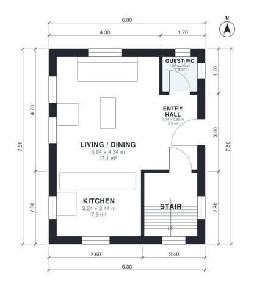

# 6 Meter Wide House Plans: 2 Bed, 970 Sq Ft Two-Story Home

This is a compact two-storey house of about 90 m² on a 6 m wide plot. The ground floor has an open kitchen, dining and living space, a guest WC and the stair next to the entry. Upstairs there are two bedrooms, a bathroom and a laundry off a central landing. Bedroom 2 and the bathroom are snug, and you can ask for them to be enlarged.

| | |
|---|---|
| Levels | 2 |
| Footprint | 6.0 m × 7.5 m (20 ft × 25 ft) |
| Rooms | 11 indoor, 0 outdoor |
| Indoor area including garage, from the room grid | about 90 m² (969 sq ft) |

## Files here

- `area-schedule.csv` (room schedule)
- `building.json` (rooms, walls, openings as data)
- `plan-level1.dxf` (floor plan, DXF, drawing units: millimetres)
- `plan-level2.dxf` (floor plan, DXF, drawing units: millimetres)

## More for this plan

- Plan page with the PDF plan set, IFC and 3D model, and a tool to change the plan: https://floorplan.ai-architectures.com/house-plans/6-meter-wide-house-plans?utm_source=github-plans&utm_medium=probe&utm_campaign=github
- PDF plan set: https://storage.googleapis.com/20img/house-plans/6-meter-wide-house-plans/plan-set.pdf
- IFC model: https://storage.googleapis.com/20img/house-plans/6-meter-wide-house-plans/model.ifc

## Known issues in this drawing

- Bedroom 2 is only 2.04 m wide.

Concept design generated with AI. Not for construction or permit; verify with a licensed professional.
