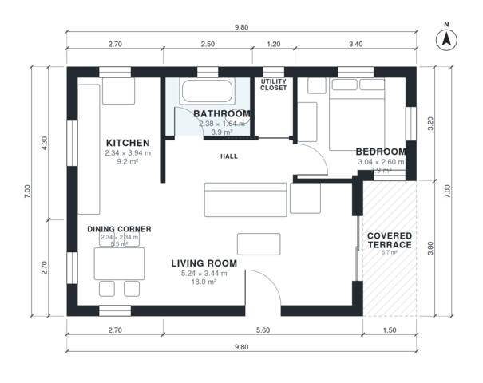

# 60 Square Meter House Plans: 1-Bed Single-Story, 680 Sq Ft

A compact single-storey one-bedroom home of about 62 m² of indoor living space, plus a 6 m² covered terrace. The front door opens into an open kitchen, living and dining area, and a short hall leads to the bedroom, bathroom and utility closet. The terrace opens off the living room through glazed doors.

| | |
|---|---|
| Levels | 1 |
| Footprint | 9.8 m × 7.0 m (32 ft × 23 ft) |
| Rooms | 7 indoor, 1 outdoor |
| Indoor area including garage, from the room grid | about 63 m² (677 sq ft) |

## Files here

- `area-schedule.csv` (room schedule)
- `building.json` (rooms, walls, openings as data)
- `plan-level1.dxf` (floor plan, DXF, drawing units: millimetres)

## More for this plan

- Plan page with the PDF plan set, IFC and 3D model, and a tool to change the plan: https://floorplan.ai-architectures.com/house-plans/60-square-meter-house-plans?utm_source=github-plans&utm_medium=probe&utm_campaign=github
- PDF plan set: https://storage.googleapis.com/20img/house-plans/60-square-meter-house-plans/plan-set.pdf
- IFC model: https://storage.googleapis.com/20img/house-plans/60-square-meter-house-plans/model.ifc

## Known issues in this drawing

- Bedroom is 7.9 m² (asked for about 12.0 m²).
- Bedroom is only 2.60 m wide.

Concept design generated with AI. Not for construction or permit; verify with a licensed professional.
