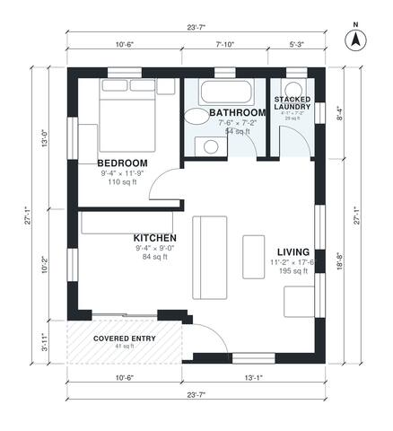

# 600 Sq Ft ADU Plans: 1-Bed, 1-Bath Detached Backyard Unit

A compact backyard ADU of about 59 m² overall (about 55 m², or 600 sq ft, of conditioned space plus a covered entry porch). It has an open kitchen and living area with windows on three sides, a private bedroom at the back, a full bath and a stacked laundry closet. The entry door opens straight into the living space.

| | |
|---|---|
| Levels | 1 |
| Footprint | 7.2 m × 8.25 m (24 ft × 27 ft) |
| Rooms | 5 indoor, 1 outdoor |
| Indoor area including garage, from the room grid | about 56 m² (598 sq ft) |

## Files here

- `area-schedule.csv` (room schedule)
- `building.json` (rooms, walls, openings as data)
- `plan-level1.dxf` (floor plan, DXF, drawing units: inches)

## More for this plan

- Plan page with the PDF plan set, IFC and 3D model, and a tool to change the plan: https://floorplan.ai-architectures.com/house-plans/600-sq-ft-adu-plans?utm_source=github-plans&utm_medium=probe&utm_campaign=github
- PDF plan set: https://storage.googleapis.com/20img/house-plans/600-sq-ft-adu-plans/plan-set.pdf
- IFC model: https://storage.googleapis.com/20img/house-plans/600-sq-ft-adu-plans/model.ifc

## Known issues in this drawing

- None found by the automatic checks.

Concept design generated with AI. Not for construction or permit; verify with a licensed professional.
