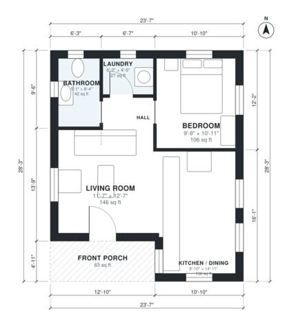

# 600 Sq Ft House Plans: 1 Bed, 1 Bath Single-Story Layout

This is a compact single-story cottage of about 600 sq ft (about 55.7 m²) of living space, with a covered front porch of about 63 sq ft on top of that. The front door opens into an open living, kitchen and dining area. A short hall leads to the private bedroom, the bathroom and a laundry closet. It's an efficient layout with good daylight, and there is no garage.

| | |
|---|---|
| Levels | 1 |
| Footprint | 7.2 m × 8.6 m (24 ft × 28 ft) |
| Rooms | 6 indoor, 1 outdoor |
| Indoor area including garage, from the room grid | about 56 m² (604 sq ft) |

## Files here

- `area-schedule.csv` (room schedule)
- `building.json` (rooms, walls, openings as data)
- `plan-level1.dxf` (floor plan, DXF, drawing units: inches)

## More for this plan

- Plan page with the PDF plan set, IFC and 3D model, and a tool to change the plan: https://floorplan.ai-architectures.com/house-plans/600-sq-ft-house-plans?utm_source=github-plans&utm_medium=probe&utm_campaign=github
- PDF plan set: https://storage.googleapis.com/20img/house-plans/600-sq-ft-house-plans/plan-set.pdf
- IFC model: https://storage.googleapis.com/20img/house-plans/600-sq-ft-house-plans/model.ifc

## Known issues in this drawing

- Bathroom is only 1.54 m wide.
- Kitchen / Dining is only 2.70 m wide.

Concept design generated with AI. Not for construction or permit; verify with a licensed professional.
