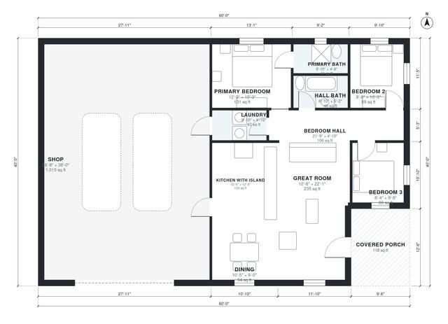

# 60x40 Barndominium Floor Plans: 3 Bed, 2 Bath, 1,170 Sq Ft

A single-story 60 x 40 ft barndominium (about 2,400 sq ft in total) with an open great room, kitchen with island and dining at the front, and a 3-bedroom, 2-bath wing with laundry along the back. The shop takes the west half of the rectangle, with a door into the laundry and kitchen. A covered porch sits at the front entry. The shop runs end-on (about 30 x 38 ft) rather than 60 x 20 ft, and the primary bath is compact. Both can be refined on request.

| | |
|---|---|
| Levels | 1 |
| Footprint | 18.29 m × 12.19 m (60 ft × 40 ft) |
| Rooms | 11 indoor, 1 outdoor |
| Indoor area including garage, from the room grid | about 212 m² (2,282 sq ft) |

## Files here

- `area-schedule.csv` (room schedule)
- `building.json` (rooms, walls, openings as data)
- `plan-level1.dxf` (floor plan, DXF, drawing units: inches)

## More for this plan

- Plan page with the PDF plan set, IFC and 3D model, and a tool to change the plan: https://floorplan.ai-architectures.com/house-plans/60x40-barndominium-floor-plans?utm_source=github-plans&utm_medium=probe&utm_campaign=github
- PDF plan set: https://storage.googleapis.com/20img/house-plans/60x40-barndominium-floor-plans/plan-set.pdf
- IFC model: https://storage.googleapis.com/20img/house-plans/60x40-barndominium-floor-plans/model.ifc

## Known issues in this drawing

- Kitchen with Island has no window.
- Bedroom 3 is 7.4 m² (asked for about 10.5 m²).
- Primary Bath is only 1.43 m wide.

Concept design generated with AI. Not for construction or permit; verify with a licensed professional.
