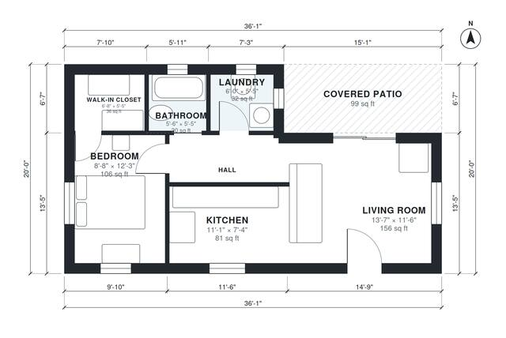

# 650 Sq Ft ADU Plans: 1 Bed, 1 Bath Backyard Cottage Layout

This is a single-storey backyard ADU on a tidy 36 ft x 20 ft footprint (about 67 m² including the covered patio, about 58 m² indoors). The front door opens into a bright open kitchen and living room that connects to the covered patio. A short hall leads to the private bedroom with its walk-in closet, the bathroom and the laundry closet.

| | |
|---|---|
| Levels | 1 |
| Footprint | 11.0 m × 6.1 m (36 ft × 20 ft) |
| Rooms | 7 indoor, 1 outdoor |
| Indoor area including garage, from the room grid | about 58 m² (623 sq ft) |

## Files here

- `area-schedule.csv` (room schedule)
- `building.json` (rooms, walls, openings as data)
- `plan-level1.dxf` (floor plan, DXF, drawing units: inches)

## More for this plan

- Plan page with the PDF plan set, IFC and 3D model, and a tool to change the plan: https://floorplan.ai-architectures.com/house-plans/650-sq-ft-adu-plans?utm_source=github-plans&utm_medium=probe&utm_campaign=github
- PDF plan set: https://storage.googleapis.com/20img/house-plans/650-sq-ft-adu-plans/plan-set.pdf
- IFC model: https://storage.googleapis.com/20img/house-plans/650-sq-ft-adu-plans/model.ifc

## Known issues in this drawing

- Bathroom is 2.8 m² (asked for about 5.0 m²).

Concept design generated with AI. Not for construction or permit; verify with a licensed professional.
