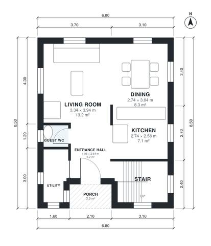

# 7 Meter Wide House Plans: 3 Bed, 2.5 Bath, 1,220 Sq Ft

A compact, narrow two-storey house of about 115 m² of living space on a 6.8 × 8.5 m footprint, with no garage and no basement. The ground floor has an open living, dining and kitchen area, a guest WC and a utility room. Upstairs are three bedrooms, a family bath and a primary ensuite, all reached from a single landing.

| | |
|---|---|
| Levels | 2 |
| Footprint | 6.8 m × 8.5 m (22 ft × 28 ft) |
| Rooms | 14 indoor, 1 outdoor |
| Indoor area including garage, from the room grid | about 113 m² (1,217 sq ft) |

## Files here

- `area-schedule.csv` (room schedule)
- `building.json` (rooms, walls, openings as data)
- `plan-level1.dxf` (floor plan, DXF, drawing units: millimetres)
- `plan-level2.dxf` (floor plan, DXF, drawing units: millimetres)

## More for this plan

- Plan page with the PDF plan set, IFC and 3D model, and a tool to change the plan: https://floorplan.ai-architectures.com/house-plans/7-meter-wide-house-plans?utm_source=github-plans&utm_medium=probe&utm_campaign=github
- PDF plan set: https://storage.googleapis.com/20img/house-plans/7-meter-wide-house-plans/plan-set.pdf
- IFC model: https://storage.googleapis.com/20img/house-plans/7-meter-wide-house-plans/model.ifc

## Known issues in this drawing

- Utility is 2.6 m² (asked for about 4.0 m²).
- Utility is only 1.00 m wide.
- Kitchen is 7.1 m² (asked for about 11.0 m²).
- Bedroom 3 is 6.8 m² (asked for about 11.0 m²).
- Bedroom 3 is only 2.04 m wide.

Concept design generated with AI. Not for construction or permit; verify with a licensed professional.
