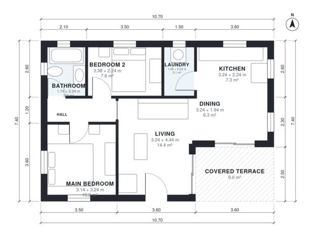

# 70 Square Meter House Plans: 2 Bed, 1 Bath, 760 Sq Ft

A compact single-storey home of about 69 m² of enclosed living space, plus a 9 m² covered terrace, on a 10.7 x 7.4 m footprint. It has an open kitchen, dining and living area, two bedrooms and a bathroom off a central hall, a laundry next to the kitchen, and a covered terrace off the living room. The dining area is slim and the bathroom is small, and both can be adjusted if you want.

| | |
|---|---|
| Levels | 1 |
| Footprint | 10.7 m × 7.4 m (35 ft × 24 ft) |
| Rooms | 8 indoor, 1 outdoor |
| Indoor area including garage, from the room grid | about 70 m² (755 sq ft) |

## Files here

- `area-schedule.csv` (room schedule)
- `building.json` (rooms, walls, openings as data)
- `plan-level1.dxf` (floor plan, DXF, drawing units: millimetres)

## More for this plan

- Plan page with the PDF plan set, IFC and 3D model, and a tool to change the plan: https://floorplan.ai-architectures.com/house-plans/70-square-meter-house-plans?utm_source=github-plans&utm_medium=probe&utm_campaign=github
- PDF plan set: https://storage.googleapis.com/20img/house-plans/70-square-meter-house-plans/plan-set.pdf
- IFC model: https://storage.googleapis.com/20img/house-plans/70-square-meter-house-plans/model.ifc

## Known issues in this drawing

- Dining is only 1.94 m wide.
- Bedroom 2 is only 2.24 m wide.

Concept design generated with AI. Not for construction or permit; verify with a licensed professional.
