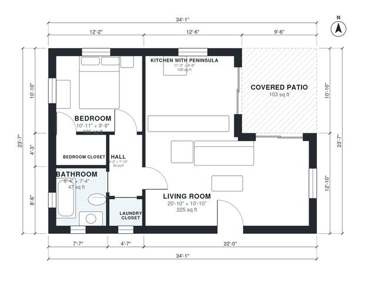

# 700 Sq Ft ADU Plans: 1 Bed, 1 Bath Detached Backyard Unit

This detached backyard ADU has about 700 sq ft (65 m²) of indoor space plus a roughly 100 sq ft covered patio. The open kitchen with a peninsula flows into a bright living room that opens onto the patio. A short hall leads to a private bedroom with a closet, a full bath and a laundry closet.

| | |
|---|---|
| Levels | 1 |
| Footprint | 10.4 m × 7.2 m (34 ft × 24 ft) |
| Rooms | 7 indoor, 1 outdoor |
| Indoor area including garage, from the room grid | about 65 m² (703 sq ft) |

## Files here

- `area-schedule.csv` (room schedule)
- `building.json` (rooms, walls, openings as data)
- `plan-level1.dxf` (floor plan, DXF, drawing units: inches)

## More for this plan

- Plan page with the PDF plan set, IFC and 3D model, and a tool to change the plan: https://floorplan.ai-architectures.com/house-plans/700-sq-ft-adu-plans?utm_source=github-plans&utm_medium=probe&utm_campaign=github
- PDF plan set: https://storage.googleapis.com/20img/house-plans/700-sq-ft-adu-plans/plan-set.pdf
- IFC model: https://storage.googleapis.com/20img/house-plans/700-sq-ft-adu-plans/model.ifc

## Known issues in this drawing

- Laundry Closet is only 1.04 m wide.

Concept design generated with AI. Not for construction or permit; verify with a licensed professional.
