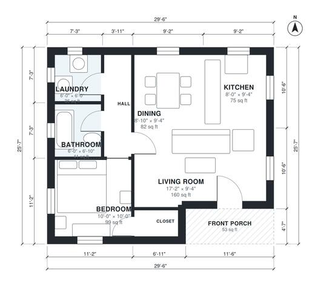

# 700 Sq Ft House Plans: 1-Bed, 1-Bath Single-Story Layout

This is a compact single-story one-bedroom cottage of about 65 m² (700 sq ft) of living space, plus a covered front porch. The front door opens into a combined living, kitchen and dining area. A short hall leads to the bathroom, laundry and a bedroom with its own closet. The layout is efficient with good daylight, and the kitchen and laundry are on the small side, as you would expect at this size.

| | |
|---|---|
| Levels | 1 |
| Footprint | 9.0 m × 7.8 m (30 ft × 26 ft) |
| Rooms | 8 indoor, 1 outdoor |
| Indoor area including garage, from the room grid | about 65 m² (703 sq ft) |

## Files here

- `area-schedule.csv` (room schedule)
- `building.json` (rooms, walls, openings as data)
- `plan-level1.dxf` (floor plan, DXF, drawing units: inches)

## More for this plan

- Plan page with the PDF plan set, IFC and 3D model, and a tool to change the plan: https://floorplan.ai-architectures.com/house-plans/700-sq-ft-house-plans?utm_source=github-plans&utm_medium=probe&utm_campaign=github
- PDF plan set: https://storage.googleapis.com/20img/house-plans/700-sq-ft-house-plans/plan-set.pdf
- IFC model: https://storage.googleapis.com/20img/house-plans/700-sq-ft-house-plans/model.ifc

## Known issues in this drawing

- Closet is 1.8 m² (asked for about 3.0 m²).
- Living Room is only 2.84 m wide.

Concept design generated with AI. Not for construction or permit; verify with a licensed professional.
